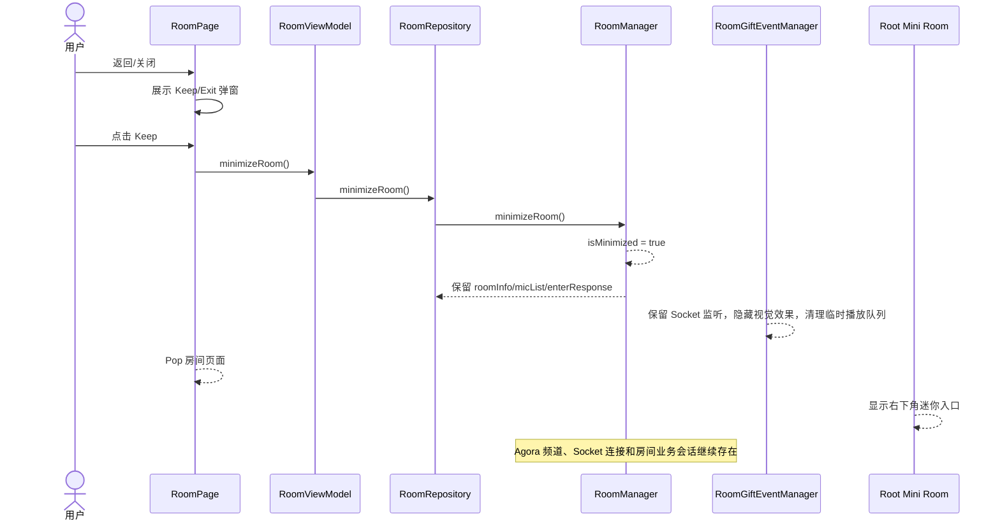
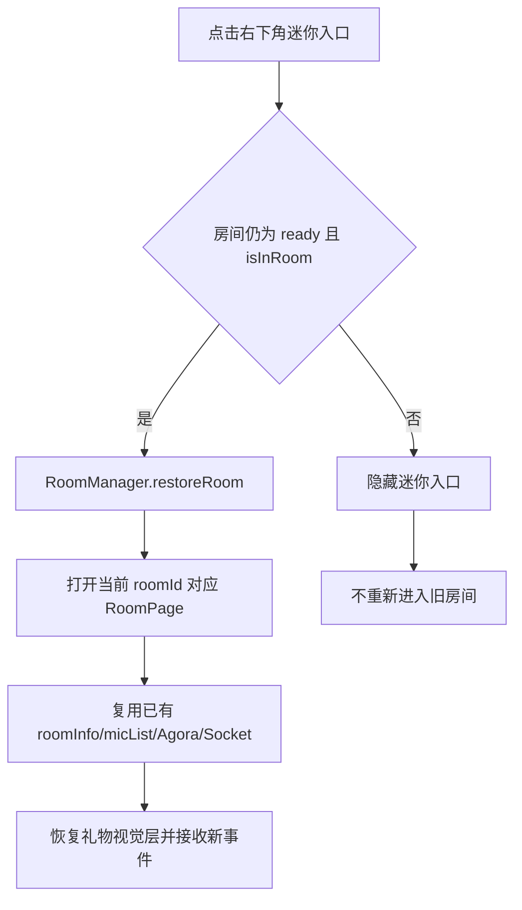
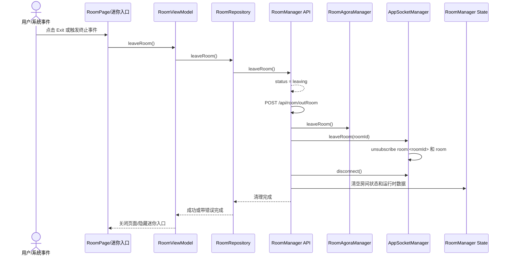
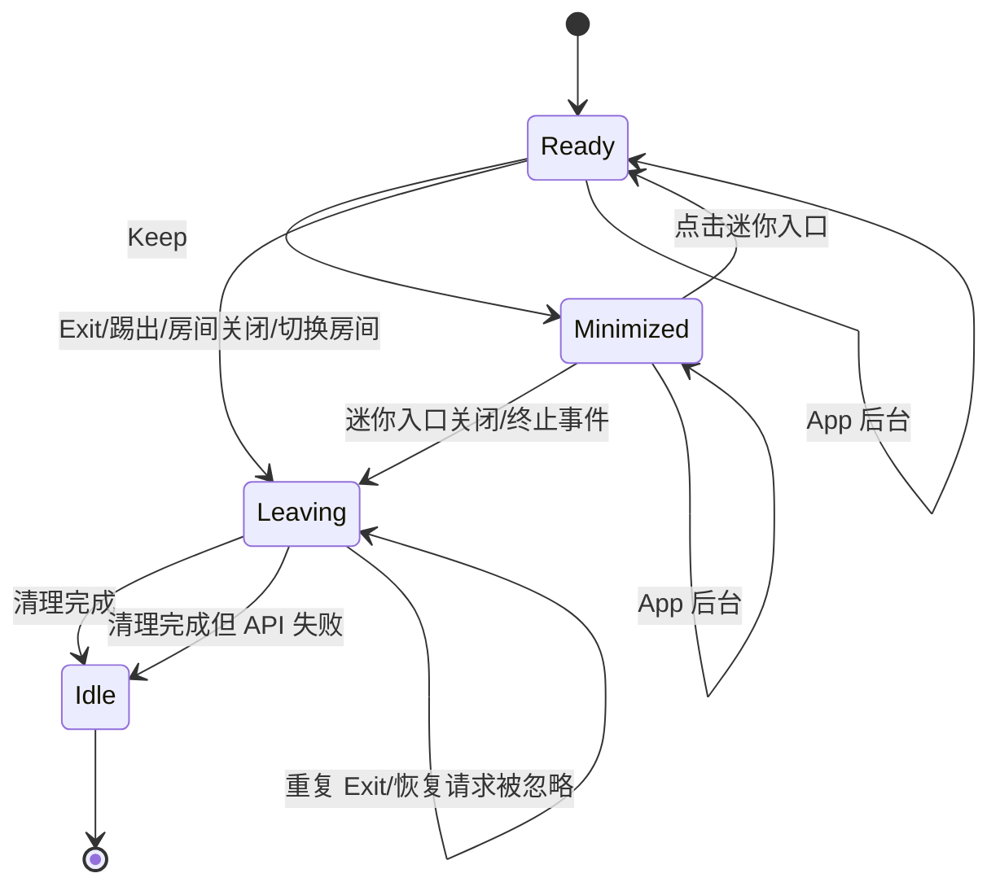

# iSnow 房间 Keep/Exit 生命周期

## 1. 文档目的

本文档定义 `iSnow` 语音房在用户离开房间 UI 时的 `Keep` 和 `Exit` 行为，供 Flutter 开发直接实现和测试。

目标体验与 Nady 当前方案一致：

- `Keep` 退出房间页面，但房间业务会话继续存在。
- `Exit` 结束房间业务会话并释放所有房间资源。
- 登录后的主要页面显示右下角迷你房间入口。
- 悬浮入口使用 Flutter 自有布局、手势和动画实现，不引入第三方悬浮窗库。

本文档仅覆盖语音房，不改变其他房间类型或普通页面的导航规则。

## 2. 现有代码边界

| 模块 | 文件 | 生命周期职责 |
| --- | --- | --- |
| 房间业务状态 | `lib/manager/room_manager.dart` | 保存当前房间、进入/保持/退出状态，协调 HTTP、Agora 和 Socket |
| Agora | `lib/manager/room_agora_manager.dart` | 初始化引擎、加入/离开频道、麦位发布状态和音频状态 |
| Socket | `lib/manager/app_socket_manager.dart` | 连接、房间频道订阅、全局频道订阅、取消订阅和断开 |
| 房间 UI | `lib/classes/room/room_page.dart` | 展示房间、拦截返回、触发 Keep/Exit、渲染悬浮入口宿主 |
| 房间页面状态 | `lib/classes/room/viewmodel/room_view_model.dart` | 将页面操作转发到 `RoomRepository`，控制页面级 loading 和错误反馈 |
| 房间代理 | `lib/classes/room/room_repository.dart` | 为 UI 提供统一房间、Agora、Socket 操作接口 |
| 礼物运行时 | `lib/classes/room/gift/event/room_gift_event_manager.dart` | 接收 Socket 礼物事件，维护卡槽、公屏、连送、轨迹和动画队列 |
| 礼物生命周期 | `lib/classes/room/gift/event/room_gift_event_provider.dart` | 最小化时保留事件监听，隐藏视觉效果；真正退房时清理并释放 |
| 应用根布局 | `lib/lib_main.dart`、`lib/configs/app_routers.dart` | 提供登录态判断和根级 Overlay 宿主 |

当前 `RoomPage` 路由位于 `ShellRoute` 外部，因此迷你房间入口不能只放在 `RoomPage` 内部。入口应挂在登录后应用根布局，才能在首页、派对页、消息页、个人页及其他主要页面持续显示。

## 3. 状态模型

### 3.1 房间状态

`RoomManager` 以一个活动房间为上限，状态含义如下：

| 状态 | `isInRoom` | `isMinimized` | Agora | Socket | 房间数据 |
| --- | --- | --- | --- | --- | --- |
| `idle` | 否 | 否 | 未加入 | 未订阅/已断开 | 已清空 |
| `entering` | 否 | 否 | 加入中或未加入 | 连接/订阅中 | 部分准备 |
| `ready` | 是 | 否 | 已加入 | 已连接并订阅 | 保留 |
| `ready` | 是 | 是 | 已加入 | 已连接并订阅 | 保留 |
| `leaving` | 退出中 | 否 | 退出中 | 取消订阅中 | 暂不允许恢复 |
| `error` | 依清理结果确定 | 否 | 必须继续清理 | 必须继续清理 | 不得阻塞退出 |

### 3.2 Keep 和 Exit 的边界

| 操作 | 页面路由 | `/api/room/outRoom` | Agora | Socket | 房间状态 | 视觉效果 |
| --- | --- | --- | --- | --- | --- | --- |
| `Keep` | Pop 页面 | 不调用 | 保持频道 | 保持连接和房间订阅 | 保持 | 隐藏当前房间视觉层，清理不应恢复后继续播放的临时队列 |
| `Exit` | Pop 页面 | 调用 | `leaveRoom()` | `leaveRoom(roomId)` 后 `disconnect()` | 清空 | 清理全部礼物和房间运行时资源 |

## 4. Keep 流程

### 4.1 触发入口

以下操作都打开 Nady 风格的退出弹窗，不直接退出：

- Android 返回键或系统返回手势。
- 房间头部关闭/返回按钮。
- 其他明确表示“离开当前房间页面”的 UI 操作。

弹窗提供两个动作：

- `Keep`：最小化并继续留在房间。
- `Exit`：完整退出房间。

### 4.2 Keep 时序



### 4.3 Keep 必须保留

- `RoomManager.state.currentRoomId`、`roomInfo`、`micList`、`enterResponse`。
- `RoomAgoraManager` 当前引擎、频道、角色、麦克风和扬声器状态。
- `AppSocketManager` 当前连接、`room:<roomId>` 订阅和全局房间订阅。
- 房间礼物事件订阅、连送确认所需的服务端事件接收能力。
- 房间音频在后台继续活动的能力。

### 4.4 Keep 时的视觉处理

按 Nady 当前方案处理：

- 房间页面销毁，页面级 Controller 可以释放。
- 礼物事件管理器不能因为页面销毁而失去房间 Socket 监听。
- 当前轨迹、全屏动画、横幅、幸运礼物等临时视觉队列不在恢复后续播。
- 礼物事件管理器进入不可见状态，清理当前播放队列，但继续接收和维护必要的业务事件。
- App 进入后台时不触发 Exit；礼物视觉层可按前后台状态隐藏，回到前台再恢复可见。

## 5. 右下角迷你房间入口

### 5.1 显示条件

入口显示条件：

```text
await AuthSession.isLoggedIn() == true
RoomManager.state.isInRoom == true
RoomManager.state.isMinimized == true
RoomManager.state.status == ready
```

未登录页面、启动页、登录页、注册页和房间已 Exit 状态不显示入口。

### 5.2 Nady 对齐行为

迷你入口应完整对齐 Nady 当前行为：

- 初始位置在屏幕右下区域，并避开底部安全区和底部导航。
- 显示房间头像/封面。
- 显示音浪波纹或等效 Flutter 动画。
- 支持水平和垂直拖拽。
- 松手后吸附到左边缘或右边缘，并保持安全边距。
- 点击头像区域恢复房间。
- 右上角关闭按钮执行真正 Exit。
- 防止恢复和关闭重复点击。

### 5.3 恢复流程



恢复时不得重复调用进房接口、重复创建 Agora 引擎或重复建立 Socket 连接。若当前房间已经进入 `leaving`、`idle`、`error` 或收到终止事件，恢复操作直接失效。

## 6. Exit 流程

### 6.1 标准退出顺序



### 6.2 Exit 必须清理

`Exit` 必须执行以下清理，不得因退出接口失败而跳过：

1. 将状态置为 `leaving`，屏蔽重复 Exit、Keep 和恢复操作。
2. 请求 `/api/room/outRoom`。
3. 捕获退出接口错误并记录日志，但继续清理资源。
4. 调用 `RoomAgoraManager.leaveRoom()`，离开 Agora 频道。
5. 调用 `AppSocketManager.leaveRoom(roomId)`，取消房间和全局房间订阅。
6. 调用 `AppSocketManager.disconnect()`，断开 Socket 连接。
7. 停止房间计时器、消息监听、礼物运行时和页面外的房间监听。
8. 清空 `currentRoomId`、`roomInfo`、`micList`、`enterResponse`、错误状态和最小化标记。
9. 清理礼物卡槽、公屏缓存、连送状态、轨迹、横幅、幸运礼物和全屏效果。
10. 隐藏并销毁右下角迷你入口。
11. 页面正常退出；接口失败通过 Toast/日志反馈，不留在不可操作的房间页面。

### 6.3 幂等和失败策略

- `leaveRoom()` 必须可重复调用，第二次调用不得重复发起资源释放或产生异常。
- Exit 进行中再次点击 Exit、Keep 或迷你入口时直接忽略。
- HTTP 退出失败不等于本地退出失败；本地资源清理仍必须完成。
- Agora 离开失败、Socket 取消订阅失败也必须继续清空本地状态，并记录错误。
- 页面是否可以关闭以“本地房间状态是否已经退出”为准，不以 HTTP 接口是否成功为准。
- 服务端最终状态依赖服务端断线检测、心跳超时和 Socket 断开兜底。

## 7. 终止事件和优先级

以下事件统一走 Exit：

- `RoomKickOutEvent`。
- 房间被关闭或服务端通知不可用。
- Socket 终止断连且无法恢复当前房间订阅。
- 用户进入另一个房间。
- Agora 频道不可恢复或被服务端强制移除。

### 并发规则



如果 Keep/Exit 弹窗、页面返回动画或迷你入口操作期间收到终止事件：

- 终止事件优先级高于 Keep。
- 关闭弹窗和迷你入口。
- 取消恢复请求。
- 进入唯一的 Exit 清理路径。
- 清理完成后不得再次打开旧房间。

## 8. App 生命周期

### 8.1 进入后台

`AppLifecycleState.inactive`、`paused` 不触发 Exit：

- 保持房间状态、Agora 频道和 Socket 连接。
- 保持服务端事件接收和必要的房间业务状态。
- 隐藏前台视觉层，避免在后台继续渲染礼物动画。
- 回到 `resumed` 后，若房间仍为 `ready + isInRoom`，允许恢复迷你入口或房间视觉层。

### 8.2 系统强杀

系统强杀进程无法保证执行 `/api/room/outRoom`。客户端不应为了强杀场景增加阻塞式退出逻辑，服务端依靠以下机制兜底：

- Agora 频道离线检测。
- Socket 断开检测。
- 服务端心跳/会话超时。
- 下一次进入房间时的服务端状态校正。

## 9. 接口和实现要求

### 9.1 `RoomManager`

必须提供或保持以下语义：

```dart
void minimizeRoom();
void restoreRoom();
Future<void> leaveRoom();
Future<void> exitMinimizedRoom();
```

- `minimizeRoom()` 只改变 `isMinimized`，不得调用退出接口、Agora leave 或 Socket disconnect。
- `restoreRoom()` 只恢复 UI 状态，不重新进房。
- `leaveRoom()` 是唯一的完整 Exit 入口，所有终止事件复用它。
- `exitMinimizedRoom()` 等价于对当前最小化房间执行完整 Exit。

### 9.2 `RoomAgoraManager`

- 只有 `RoomManager`/`RoomRepository` 协调 Agora 生命周期。
- Keep 不调用 `leaveRoom()`、`release()` 或重新初始化引擎。
- Exit 调用 `leaveRoom()`；是否释放引擎由应用全局 Agora 复用策略决定，但不能继续保留当前房间频道。

### 9.3 `AppSocketManager`

- Keep 保持连接和房间频道订阅。
- Exit 按 `leaveRoom(roomId)` 取消房间订阅，再调用 `disconnect()`。
- 终止断连事件不得触发自动 Keep，只能进入 Exit。

### 9.4 `RoomPage` 和根级迷你入口

- `PopScope` 只能触发退出弹窗，不得绕过 Keep/Exit 分流。
- Header 的 Keep 回调先更新房间最小化状态，再 Pop 页面。
- Header 的 Exit 回调等待本地退出完成后关闭页面。
- 根级迷你入口监听 `RoomManager` 状态，不依赖已经销毁的 `RoomPage` Controller。
- 入口只能在登录态和 `ready + isInRoom + isMinimized` 时可见。

## 10. 测试方案

### 10.1 单元测试

覆盖以下场景：

| 场景 | 关键断言 |
| --- | --- |
| Keep | 不调用 `/api/room/outRoom`、Agora leave、Socket leave/disconnect |
| Keep 状态 | `isInRoom=true`、`isMinimized=true`、房间数据保留 |
| Exit 成功 | API、Agora、Socket 和本地状态全部完成清理 |
| Exit API 失败 | 页面仍可退出，Agora/Socket/本地状态仍清理，错误被记录 |
| Agora/Socket 清理失败 | 继续执行剩余清理，最终房间状态不再可恢复 |
| 重复 Exit | 只执行一次有效清理，不抛异常 |
| Exit 中恢复 | 恢复请求被忽略 |
| 踢出/关闭房间 | 统一进入 Exit |
| App 后台 | 不调用 Exit，房间会话保持 |
| 切换房间 | 先完整 Exit 旧房间，再进入新房间 |

### 10.2 Widget 测试

- Android 返回键和房间关闭按钮展示 Keep/Exit 弹窗。
- Keep 后 `RoomPage` 消失，房间资源仍保持，迷你入口出现。
- 迷你入口点击恢复同一 `roomId`，不重复调用进房、Agora 初始化或 Socket 连接。
- 迷你入口支持拖拽和左右边缘吸附。
- 迷你入口关闭执行 Exit 并消失。
- Exit API 失败时页面仍消失，错误反馈可见，资源清理完成。
- 首页、派对页、消息页、个人页及其他登录后主要页面可显示迷你入口。
- 未登录页面不显示迷你入口。
- Exit 进行中重复点击、恢复和返回操作被忽略。
- 收到终止事件时，弹窗和迷你入口关闭，不能恢复旧房间。

### 10.3 设备验收

- Keep 后继续收到房间 Socket 消息。
- Keep 后 Agora 语音仍可收听，后台停留后回到前台仍可恢复。
- Keep 后房间公屏、礼物卡槽、连送状态和业务事件按 Nady 方案工作。
- Exit 后 Agora 不再处于当前房间频道，Socket 不再订阅当前房间。
- Exit 后从多个主要页面都无法恢复旧房间。
- 收到踢出或房间关闭事件后，迷你入口立即消失且不能重新打开。

当前项目没有 `integration_test/` 目录，先以单元测试、Widget 测试和真实设备验收覆盖；后续增加端到端测试时沿用本节场景。

## 11. 现有测试契约调整

`test/room_exit_test.dart` 中原有“退出失败后留在房间页面并重试”的预期需要改为：

1. 模拟 `/api/room/outRoom` 失败。
2. 仍完成本地 RoomState、Agora、Socket 和页面 Controller 清理。
3. `RoomPage` 正常退出，迷你入口不保留。
4. 展示非阻塞错误反馈或记录日志。
5. 不需要用户再次点击 Exit 才能释放资源。

这条测试契约与生产实现的原则一致：服务端退出失败不应阻塞客户端本地退出。

## 12. 本次落地说明（2026-10-11）

### 12.1 退出登录顺序

`ProfileViewModel -> ProfileRepository -> LoginProvider.logout()` 按以下顺序执行：

1. 保留当前登录凭据，等待唯一的 `RoomManager.leaveRoom()` 完成。
2. 用原登录凭据调用已有退出登录接口。
3. 无论退出房间接口或退出登录接口是否失败，都清除本地登录信息。
4. Profile 页面沿用现有登录页跳转；登录状态通知隐藏迷你入口。

普通退出登录对齐 Nady 的本地退出兜底。账号注销同样先退房，但注销接口失败仍返回错误，不将服务端注销失败提示为成功。房间页面和 Profile 页面释放时，迟到的请求回包不得恢复旧房间或旧账户数据。

### 12.2 页面和会话分离

- `RoomExitDialog` 使用 Nady Keep/Exit 图片和布局；点击空白区域只关闭弹窗。Header 和系统返回共用它，Header 最小化按钮直接执行 Keep。
- `RoomPage` 的 autoDispose ViewModel 在 Keep 和 Exit 后均释放，迟到的聊天发送/刷新回包不再更新已销毁的 Controller。`RoomManager` 与根级 `RoomSessionViewModel` 管理房间会话，不随页面释放。
- `RoomMiniOverlay` 挂在 `MaterialApp.router.builder`，覆盖登录后页面；公开路由和房间路由隐藏入口。拖拽支持 XY 方向，松手吸附边缘并避开安全区、键盘与底部导航。
- 恢复复用当前会话，只推入对应房间页面，不请求进房接口或重新连接 SDK。恢复/关闭操作有互斥保护，终止事件会取消恢复资格。
- 切换房间时精确移除旧房间路由，不误 Pop 新打开的房间页面。
- Keep 和后台只清空礼物视觉队列，保留业务确认、公屏记录和连送状态；Exit 立即关闭事件接收资格、清空业务数据并释放订阅，迟到的礼物事件不再渲染。

### 12.3 清理和终止事件

- 重复 Exit 共用同一个 Future。先使当前会话失效，再等待已发出的进房/SDK 加入任务结束，以实际返回的房间 ID 请求退房。
- API、Agora leave、Socket unsubscribe/disconnect、后台音频服务 stop 分步捕获错误并记录日志，最终强制回到 `idle`。
- Agora 离开失败会尝试释放引擎；Socket 单个取消订阅失败不阻止其他订阅和连接清理。
- 短暂网络重连不退出；Centrifuge 最终断连、房间订阅终止、Agora 不可恢复失败或服务端封禁统一走 Exit。
- `RoomKickOutEvent` 按 Nady 的 `roomId + from.uid` 判断，只退出匹配房间的当前用户，不能因广播踢出其他人而误退房。
- Nady 当前未定义独立的房间关闭事件名。本次不虚构 `RoomCloseEvent`；关闭导致的订阅终止/连接终止按上述路径处理。服务端以后新增关闭事件时须按真实协议接入同一 Exit 入口。
- 第 3.1 节的 `ready` 表示进房业务成功，不保证 Agora/Socket 已完成加入。沿用当前 Nady 对齐逻辑：进房接口成功后可展示房间，音频加入失败保留房间并显示 Agora 错误；不可恢复的连接终止再执行 Exit。

### 12.4 后台音频

- Android 增加原生 `RoomAudioService` 和 `isnow/room_audio` MethodChannel；由独立 `RoomBackgroundAudioManager` 串行管理，不依赖页面 Controller，无新增 Flutter 依赖。
- 前台加入 Agora 时启动 mediaPlayback 服务；发布麦克风且已获录音权限时启用 microphone 类型。Android 14+ 的启动/升级只在前台进行，后台请求延迟到 resumed 重试，不绕过系统权限限制。
- Keep、inactive 和 paused 不停止服务；Exit/退出登录停止服务。退出与启动并发时，等待启动结束后停止，避免退出后迟到启动留下服务。
- Android 声明前台音频服务与通知权限；未授予通知权限时通知展示受系统限制，不等于已获得录音权限。任务移除时原生服务停止，进程强杀仍依靠服务端断线兜底。
- iOS 声明 `UIBackgroundModes: audio`，音频会话仍由 Agora 管理，不引入第二套音频会话。

平台约束参考 [Android 前台服务类型](https://developer.android.com/develop/background-work/services/fgs/service-types)、[Android 14 前台服务要求](https://developer.android.com/about/versions/14/changes/fgs-types-required) 和 [Apple UIBackgroundModes](https://developer.apple.com/documentation/BundleResources/Information-Property-List/UIBackgroundModes)。配置和单元测试不能代替真实设备后台收听/上麦验收。

### 12.5 验证入口

| 测试文件 | 覆盖范围 |
| --- | --- |
| `test/room_manager_lifecycle_test.dart` | Keep/恢复、完整 Exit、各步失败、幂等、迟到进房/详情、SDK 加入竞态、终止事件、切换房间、退出登录凭据顺序 |
| `test/app_socket_manager_test.dart` | 频道清理失败兜底、主动断开与可恢复/不可恢复连接信号 |
| `test/room_agora_lifecycle_test.dart` | 角色恢复失败、频道离开失败释放、迟到回调、网络重连和封禁 |
| `test/room_background_audio_test.dart` | 服务去重、后台保持、前台重试、启动/停止竞态、失败不阻塞房间清理 |
| `test/profile_logout_lifecycle_test.dart` | 退出登录去重、迟到用户资料丢弃、页面释放后重建 Controller |
| `test/room_exit_test.dart` | Header/返回弹窗、空白关闭、页面 Controller 释放、根级入口、320/375/430 宽度拖拽恢复、后台保持、登录失效、切换路由 |
| `test/room_gift_events_test.dart` | 隐藏时维持业务确认、公屏记录，Exit 后丢弃迟到事件 |

设备验收仍须按 10.3 节执行，特别是 Android 14+ 的后台收听/上麦、iOS 后台音频、真实 Socket 踢出及退出后的通知消失。本次自动化验证不操作真实收费礼物，也不安装 APK 覆盖已有 Nady 应用。

### 12.6 本次验证结果

- `flutter test --no-pub`：165 项通过，1 项既有失败。失败位于 `test/login_detail_page_test.dart:32`，仍断言默认区号为 `+996`，与当前登录页不符；本次未改动该页面或该测试。
- `flutter analyze --no-pub`：没有 error 或新增 lint，仅保留 `room_chat_panel.dart:3` 中既有的 `_RoomMusicStrip` 未使用 warning。
- `flutter build apk --debug --no-pub -t lib/lib_dev.dart`：成功；产物为 `build/app/outputs/flutter-apk/app-debug.apk`，未安装覆盖已有应用。
- `plutil -lint ios/Runner/Info.plist`、资源 manifest、三个本地 Nady 图标、assets 声明及 `git diff --check` 校验通过；房间 UI 未新增 Flutter `Icon`/`Icons.*`。
- 已检查 Keep/Exit 弹窗与迷你入口的 Widget 截图，并覆盖 320/375/430 宽度。四张既有礼物截图基线只移除了此前已取消的 `Gift sent` 提示，未恢复该 Toast。
- Android/iOS 真机后台音频和真实服务端终止事件尚未验收；iOS 本次只校验配置，未执行 iOS 编译。
