# iSnow 语音房“更多”完整功能迁移文档

## 1. 交付说明

| 项目 | 内容 |
| --- | --- |
| 版本 | v1.0 |
| 核验日期 | 2026-10-18 |
| 使用者 | iSnow Flutter 开发、后端联调、测试 |
| 参考项目 | `/Users/huili/nady`，核验时 HEAD 为 `a0c1fc244`，以实际工作区源码为准 |
| 目标项目 | `/Users/huili/project/iSnow`，核验时 HEAD 为 `9a49def`，以实际工作区源码为准 |
| 本次交付 | 一份主 Markdown；不修改业务代码，不创建额外 HTML 原型 |
| 覆盖范围 | 语音房“更多”全部入口，以及可达的二级页面、弹窗、操作、结果和实时事件 |
| UI 原则 | 保留 iSnow 现有更多面板；新增页面沿用 iSnow 主题与资源规范 |
| 业务原则 | 对齐 Nady 当前实际启用的业务；接口、权限、事件名称和字段保持兼容 |

本文依据客户端源码提取，不代表已使用真实后端、第三方游戏或支付环境联调。文中的 JSON 示例是字段说明，不是真实用户数据、生产配置或请求抓包。

约定三种描述：**现有实现**表示已在工作区定位；**迁移要求**表示 iSnow 后续开发必须完成；**待配置/待核验**表示当前缺少外部配置或调用证据，不允许以假接口、假奖励或空白目标页冒充完成。

### 1.1 背景、目标与边界

iSnow 已有更多面板，但部分入口仍显示 `room.more.actionPending`；部分已接接口的入口缺少 Nady 的目标容器、共享状态或结果回流。完成标准是“点击到业务结果闭环”，不是把占位提示替换成一次 `push`。

| 目标类型 | 描述 | 衡量指标 | 目标值 |
| --- | --- | --- | --- |
| 功能 | 已启用入口完成完整链路 | 入口到二级操作、结果、返回均可验收 | 全部已启用功能 |
| 协议 | 延续 Nady 后端契约 | 请求方法、路径、字段及 Socket 名称对照 | 全部已确认契约一致 |
| 状态 | 进入二级页面保持房间活动 | Agora/Socket/音乐不因页面覆盖而重建 | 同房会话零重复创建 |
| 可靠性 | 修复重复提交和过期回调等缺陷 | 文末关键测试场景 | 全部通过 |
| 配置 | 缺少参考或 iSnow 专属配置有明确标记 | 未配置项被识别且可重试/关闭 | 不伪造可用状态 |

不在本次范围：重新设计现有更多面板、重写钱包支付、实现第三方 H5 内部游戏规则、假定枚举中所有模式都已启用。既有音乐、礼物和 Keep/Exit 能力继续复用，但从更多进入它们的链路及关联状态必须纳入验收。

### 1.2 阅读导航

- 第 2 节：现状差异与迁移清单。
- 第 3 至 4 节：架构、导航、生命周期和权限。
- 第 5 至 14 节：各入口及目标页面的完整流程。
- 第 15 至 16 节：HTTP 和 Socket 契约字典。
- 第 17 至 20 节：缺陷修正、接入配置、实施顺序及测试。
- 第 21 节：源码索引和现有文档。

## 2. 现状与完整功能清单

| ID | 功能 | Nady 当前路径 | iSnow 当前情况 | 迁移完成标准 |
| --- | --- | --- | --- | --- |
| M01 | 分享 | 素材加载 → 海报/外部分享、最近聊天、好友 → 确认发送 → 私聊 | 更多入口占位；已有 IM 基础设施 | 素材、短链、渠道、搜索、邀请消息、接收卡片和返回全闭环 |
| M02 | 举报 | 整页表单 → 相册 → 上传截图 → 提交举报 | 更多入口占位 | 原因、说明、截图、提交、成功返回及失败重试 |
| M03 | 音乐 | 关闭更多 → 播放器 → 上麦/占用检查 → 共享播放 | 已有面板、曲库、Agora 混音和占用流程 | 复用并核验入口、接管、实时状态及退出释放 |
| M04 | 魅力计数 | 房间级开关；麦位魅力展示可打开贡献详情 | 更多入口占位 | 开关查询/提交/事件同步、详情、贡献人主页和送礼 |
| M05 | 声音 | 本人的房间收听开关 | 已接 `toggleSpeaker()` | 真实 SDK 状态、持久化、错误回滚，不影响人声发布 |
| M06 | 动效设置 | 本人按账号保存六项设置 | 更多入口占位；已有礼物动画运行时 | 设置页及实际各视觉通道同步响应 |
| M07 | 魅力设置 | 金币/钻石统计方式二选一 | 更多入口占位 | 请求成功更新、事件同步、麦位及详情单位同步 |
| M08 | Chat / Win / Treasure | 配置驱动 → 打开/恢复/关闭房间游戏区域 | 六种枚举直接铺出，接口开关已有 | 按真实配置构建入口，完成游戏区、记录、折叠/恢复及实时反馈 |
| M09 | PK | 1V1/多人设置 → 选麦位和时长 → 进行中 → 提前/正常结束 → 结果 | 更多入口占位 | 设置、比分、倒计时、送礼、终止、结果、恢复 |
| M10 | 幸运宝箱 | Room/World → 配置 → 发送 → 列表/倒计时 → 开箱 → 结果；世界横幅跳房 | 更多入口占位；公屏仅有部分事件分类 | 发送、首次说明、规则、领取队列、金币结果及跨房链路 |
| M11 | 动态工具 | Banner position=7 → 普通浏览器 | 已有通用跳转 | 参数合并、标题栏、桥接、返回和错误页 |
| M12 | 游戏 Banner | Banner position=5 → 专用游戏容器 | 当前与动态工具共用普通 WebView | 游戏 Token、专用桥接、充值、礼物、实时消息和关闭 |

上述 M08、M09、M10 的大部分目标界面是**房间内面板或视觉区域**，不能一律改成新的整页路由。

### 2.1 典型用户旅程

| 阶段 | 用户触点 | 用户行为 | 当前痛点 | 迁移后的行为 |
| --- | --- | --- | --- | --- |
| 进入 | 房间底栏更多按钮 | 打开面板 | 静态入口可能与权限/配置不符 | 查询配置，渲染当前角色实际可用入口 |
| 选择 | 基础工具/模式/Party/Game | 点击功能 | 多个按钮仅提示未实现 | 先校验会话和权限，再执行切换或打开对应页面 |
| 操作 | 二级表单/面板/游戏 | 选人、上传、开关、发送、充值 | 跳转后缺少业务处理 | 提交前校验、期间防重、按真实结果更新 |
| 反馈 | 房间麦位、公屏、比分、动画 | 查看自己和他人的操作 | 只更新本地或无事件订阅 | HTTP 回执与 Socket 共同更新共享状态 |
| 返回 | 返回键/关闭按钮 | 回到房间 | 容易误触发 Keep/Exit 或重复进房 | 只关闭自己拥有的页面/弹层，复用原会话 |
| 异常 | 断网/权限变更/被踢 | 重试或退出 | 旧回调可能操作新房间 | 原会话失效后丢弃旧结果；Exit 统一清理 |

## 3. 架构、导航与生命周期

### 3.1 复用现有架构

依赖保持 `View → ViewModel → Repository → Service/Manager`：

| 层 | 复用/扩展点 | 具体责任 |
| --- | --- | --- |
| View | 更多面板、各 Sheet、举报页、游戏容器 | 渲染、用户输入、执行导航效果；不直接调用 HTTP/存储 |
| ViewModel | 现有 `RoomMoreToolsViewModel`；新增按功能划分的 VM | 校验、loading、提交锁、错误、导航意图及二级页面流程 |
| Repository | 现有 `RoomMoreToolsRepository`；按域补充举报/邀请/PK/宝箱等 Repository | 使用 `HttpDioManager`，解析为类型化结果，封装存储与 SDK 适配 |
| RoomManager | 当前房间会话、真实 roomId、房间代次 | 房间共享状态和全局事件协调；统一进入/退出 |
| AppSocketManager | 现有单一 Socket 客户端 | 提供频道订阅和消息流，不创建第二套连接 |
| Agora/音乐 | 现有 `RoomAgoraManager`、`RoomMusicRepository` | 语音、混音、角色、占用、后台播放 |
| 钱包/IM/Web | 现有钱包、`ImRepository`、`WebBridgeViewModel/Repository` | 支付和 IM 真结果、共用桥接请求能力 |

新增业务 API 路径集中声明到 `HttpApi`。Nady 请求统一通过 `HttpDioManager`，不照搬 Nady View 中直接发请求的代码。

按功能建立状态类，例如 PK、宝箱和分享各有 VM；不要继续将所有网络流程堆进 `room_more_tools_sheet.dart`。这些是目标职责，不能把建议类名当作当前已存在实现。

### 3.2 统一点击入口

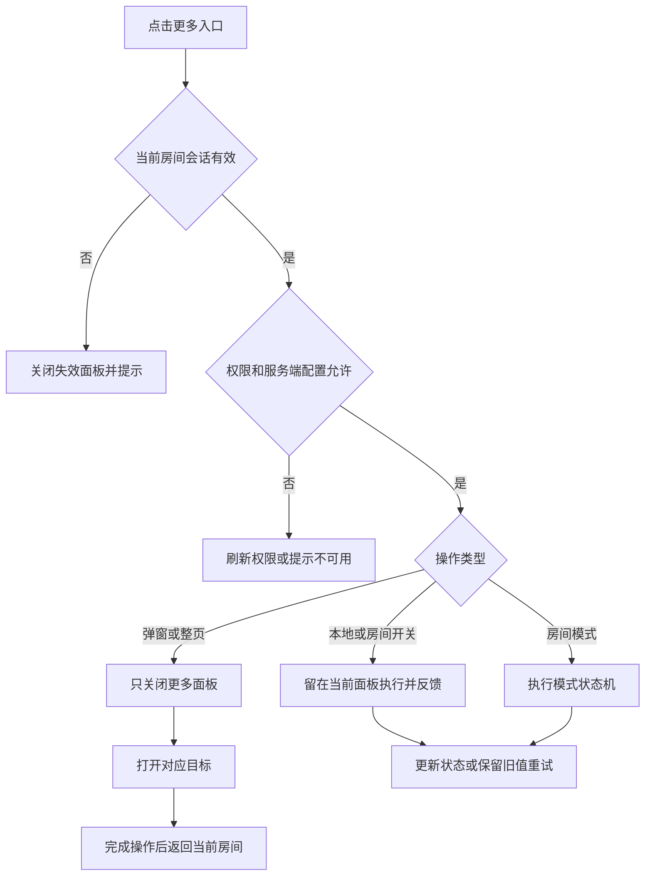

点击前保存 `{canonicalRoomId, roomSessionGeneration, uid}` 快照。异步返回时同时核对房间 ID 和代次，不能只判断 `mounted` 或 ID 相同；退出后重新进入同一 ID 也是新会话。

共享守卫：房间不是 `ready + isInRoom`、正在 Exit、权限已撤销、配置已禁用或同操作 busy 时，不启动新的提交/导航。

### 3.3 目标页面与返回约定

| 入口 | 目标形态 | 关闭更多 | 返回/成功后 |
| --- | --- | --- | --- |
| 分享 | 分享 Sheet；外部 App；发送确认；私聊页 | 是 | 取消回房间；IM 确认成功后打开该私聊，原房间会话仍在 |
| 举报 | 完整举报页 | 是 | 成功 Pop；取消返回；失败留页重试 |
| 音乐 | 现有音乐 Sheet | 是 | 只关闭播放器面板，保持播放 |
| 魅力计数/声音 | 原面板开关 | 否 | 请求/SDK 成功更新图标；失败保留原值 |
| 动效设置/魅力设置 | 设置 Sheet | 是 | 返回只关闭设置，不退房 |
| Chat/Win/Treasure | 房间内游戏区域和折叠入口 | 成功后是 | 模式关闭或折叠按第 12 节处理 |
| PK | PK 设置 Sheet → 房间 PK 层 → 结果 | 是 | 设置取消不启动；关闭结果不退房 |
| 幸运宝箱 | 编辑、规则、列表、开箱和结果 Sheet/弹层 | 是 | 单独关闭当前层，不关闭整个房间 |
| 动态工具 | 现有普通 WebView | 是 | Pop WebView 回房间 |
| 游戏 | 专用游戏容器 | 是 | 返回/JS close 只关游戏 |

可给举报新增内部路由，例如 `/room/:roomId/report`；这是**建议新增路由**，不是已有路由或后端 API。普通网页、钱包、私聊和用户主页复用现有 `/web-view`、`/wallet`、`/chat-view`、`/profile-homepage/:targetUid`。

只使用 `push` 或叠加 Sheet 覆盖原房间；不得因为举报、私聊或充值导航执行 `go('/party')`、`leaveRoom()` 或重新 `enterRoom()`。整页覆盖时，房间 UI 可见性与会话存活分开；根据已有全局迷你入口规则处理展示和恢复，不能由页面 `dispose` 推断退房。模态设置不应触发房间 Keep/Exit 弹窗。

### 3.4 会话生命周期

| 场景 | 业务状态/监听 | 视觉状态 | Agora/Socket/音乐 |
| --- | --- | --- | --- |
| 更多或二级面板打开 | 保持 | 顶层面板展示，其余视觉按遮挡处理 | 保持 |
| 外部分享/钱包/网页/私聊覆盖 | 保持；必要时回前台刷新快照 | 不在无关页面播放房间临时全屏效果 | 保持 |
| Keep | 保持 PK、宝箱列表、共享开关和必要事件订阅 | 不重播过期视觉；恢复时查询当前快照 | 保持 |
| App 后台 | 不主动 Exit；允许现有连接和音频活动，受系统运行能力约束 | 暂停渲染；回前台校准倒计时和结果 | 按现有后台音频策略保持 |
| 踢出/房间关闭/切房/退出登录/终止断连 | 会话失效，关闭关联目标和提交入口 | 清空本房间弹窗、游戏回调和临时队列 | 复用现有 Exit 清理链 |

短暂重连不在本功能层另定退房规则，交给现有 RoomManager 判断；恢复成功后拉取 PK、宝箱列表、模式和共享开关，不能只依赖可能丢失的 Socket 增量。强杀不保证执行客户端退出请求，沿用服务端断线超时兜底。

### 3.5 弹层和异步处理约定

1. 更多、确认、规则、宝箱、游戏和充值各持有自己的导航/弹层句柄；关闭时按自身句柄处理，不使用无作用域的“关闭全部”。
2. 从更多打开目标时等待更多关闭完成，再校验会话和权限，使用仍挂载的根导航上下文。
3. 请求使用 `try/catch/finally` 释放 busy/loading。错误进入 VM 可展示状态，不能只写日志或把失败当成空数据。
4. 发宝箱、举报、发邀请、PK 开始/结束、模式切换使用各自提交锁。不要自动重试非幂等交易。
5. 页面关闭取消页面级计时器/监听；房间级监听由会话所有者释放。关闭游戏只退订该游戏消费者，不断开其他模块仍使用的频道。
6. 权限和配置既控制入口可见性，也在提交前二次核对。界面灰掉不等于服务端授权。

## 4. 权限与配置矩阵

| 功能 | 普通用户 | 管理员/房主 | 其他条件 |
| --- | --- | --- | --- |
| 分享、举报 | 可用 | 可用 | 当前房间有效 |
| 音乐更多入口 | 不显示 | 显示 | 实际控制前还要上麦、会话有效并满足播放器占用规则 |
| 魅力计数开关、魅力设置 | 不显示 | 显示 | 服务端仍有最终权限判断 |
| 声音、动效设置 | 可用 | 可用 | 仅影响本人 |
| 房间模式切换 | 不显示 | 显示 | 还需命中 function2 配置 |
| PK 设置/提前结束 | 不显示 | 显示 | 已有 PK 不能重复开始；选手必须是当前有效麦位用户 |
| PK 观看/送礼 | 可用 | 可用 | 由实时 PK 状态驱动，不要求有设置权限 |
| 幸运宝箱更多入口 | `config.visible == true` 时显示 | 显示 | Nady 实际规则为管理角色 OR visible；不是整个 Party 分区统一管理角色门槛 |
| 宝箱领取/结果/世界横幅 | 按服务端派发与领取资格 | 同左 | 领取是否成功由服务端决定 |
| position=5/7 动态入口 | 有对应配置时显示 | 同左 | URL、活动有效性和客户端已有开关策略 |

未知身份按最低权限处理。Nady 身份事件 `RoomIdentityUpdateEvent` 的 `roomIdentity=1000` 对应管理员、`2000` 对应房主，其他回普通用户；不能把该事件直接套用 iSnow 进房枚举的 `0/1/2` 转换。身份变动后同步重算入口，并阻止已打开设置页继续提交越权操作。

## 5. M01 分享与房间邀请

### 5.1 页面、数据与前置条件

目标包含分享海报区域、Share/Recent Chats/Friends 三个 Tab、搜索、用户项、发送确认弹窗和私聊房间卡片。保留 iSnow 主题；素材内容来自接口。

打开更多的 Share：等待更多关闭动画完成 → 校验房间代次仍有效 → 在根导航打开分享 Sheet，不跳转 `/room-tool`，不退出房间。固定保留 Share、Recent Chats、Friends 三个分类，首次打开默认 Share。素材、最近聊天和好友独立加载；加载、空结果、失败和重试完成均不改变当前分类，用户主动切换的 Tab 不被迟到请求覆盖。

公开素材缓存按 API 环境和语言隔离，并合并相同 key 的并发请求；空结果和失败不永久缓存。邀请码、解析后的个人文案与链接仅保存在本次分享会话，不跨账号复用。Share 内独立展示加载、暂无分享素材或服务端错误（优先 msg）及重试；无素材时不显示海报、复制或系统分享操作，不伪造内容。最近聊天和好友不展示重复的素材重试入口；素材重试不重新加载联系人，也不自动切回 Share。

当前版本以用户提供的 `Screenshot_2026-10-27-17-12-45-30_f451bd7b6af29514306158c2ac13b20b.jpg` 为分享UI参考，取代此前仅「复制/系统分享」的布局。海报完整等比显示，左右圆形箭头循环切换，与滑动共享索引；单张不显示箭头。底部白色24px顶圆角面板使用42px缩略图、单行省略文案与链接、60×32px图片复制按钮和固定五列两行渠道网格；第二行靠左。海报只作素材预览，实际外发为文案和链接，不生成或下载海报附件，也不硬编码截图海报或背景。

`GET /api/invite/materials` 查询：`appScene=ROOM_SHARE`、`sub-scene=ROOM_SHARE`、`language=<当前语言>`。注意 `sub-scene` 包含连字符。

素材字段：`id`、`imageUrl`、`copyText`、`jumpLink`、`sortNo`、`subScene`、`resolvedLanguage`。文案替换 `${nickname}`；链接替换 `${nickname}`、`${shareUid}`、`${shareRoomId}`、`${inviteCode}`。`shareUid` 为账号 UID，`shareRoomId` 为真实房间 ID，均不能用展示编号代替。邀请码沿用 `GET /api/invite/info` 返回值。

`jumpLink` 按 Nady 模型允许为空。素材只要有海报、非空白文案或目标链接之一就保留，仅剔除完全空记录；不能把“没有目标链接”当成“没有海报素材”。`subScene`、`resolvedLanguage` 保留在类型化模型中。无目标时仍展示接口海报、文案和 H5 外层链接，`og_url` 保持空值；不编造房间协议、不填入其他素材目标，也不将渠道参数放到H5包装层。有目标时继续执行既有协议安全校验、占位符替换和渠道归因。

### 5.2 外部分享和短链

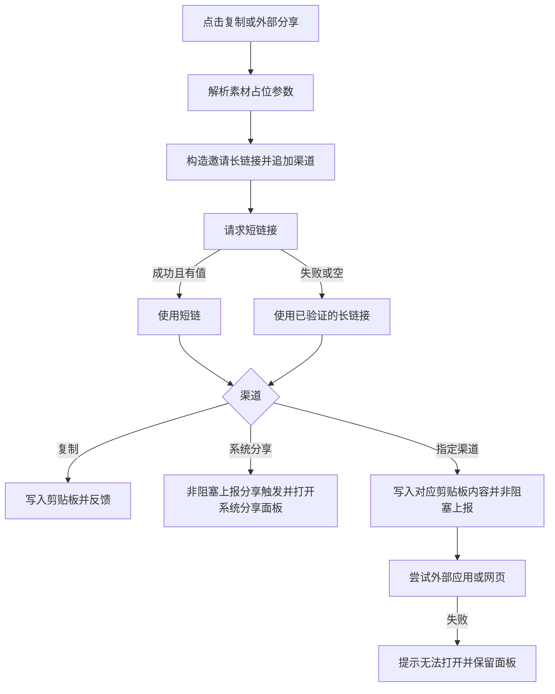

经本次明确确认，默认沿用 Nady 当前 API `Uri.origin` 下的 `/h5/invite`，参数为 `og_title`（当前 iSnow）、`og_description`、`og_image`、`og_url`。保留素材里的 Nady 目标协议，不要求必须配置一个尚未接入的 iSnow 协议。文案按占位符解析，目标链接按各 URI component 分别替换和编码，保留原有 query/fragment，昵称里的 `&`、`#` 等不能注入查询参数。H5外层查询参数按Nady逐项使用 `Uri.encodeComponent` 编码，并显式保留 `key=value`：无目标时必须为 `og_url=`，不能让 `Uri(queryParameters: ...)` 将其序列化成裸 `og_url`；后者会触发当前短链服务的1003错误。自定义页面的重复参数、空值和fragment均保留。

仅在用户复制或执行外部分享时调用 `POST /api/share/short-links/batch`：

```json
{
  "shortBaseUrl": "https://configured-origin.example",
  "originalShareUrls": ["https://configured-origin.example/h5/invite?..."]
}
```

返回列表元素为 `{shortUrl, expireAt}`。`shortBaseUrl` 使用当前API环境地址的 `Uri.origin`（保留非默认端口、不携带 `/simi` 等路径）；即使自定义 `ISNOW_INVITE_BASE_URL` 使用其他落地页域名，也不改变短链服务域名。短链失败、空结果或不安全的短链继续回退长链，不使 IM 邀请失效。

经本轮用户再次确认，按截图顺序恢复 WhatsApp、Facebook、Snapchat、Telegram、Messenger、X、Instagram、Contacts、Others 九个入口，覆盖此前统一系统分享的约定。`RoomShareAction` 保留 copy/system（system 对应 Others），并增加八个指定渠道。归因值为渠道准确名称，复制为 `Copy`；`shareChannel` 加到目标链接内，再由 `og_url` 装载，不放在 H5 包装层。Facebook、Messenger 只向剪贴板写链接，其余动作写文案和链接组合。

平台能力复用已有 `url_launcher` 和 `share_plus`，由 `RoomShareManager` 封装剪贴板、可注入的外部启动器及系统分享，不新增库、社交 SDK 或原生桥接。WhatsApp/Snapchat/Telegram/Messenger/X/Instagram 沿用 Nady 的 Scheme，Facebook 使用外部 `facebook.com/sharer/sharer.php`，Contacts 使用 `sms:?body=...`，不是读取手机通讯录，无需联系人权限。Others 打开系统分享；必须传有效、位于可见窗口内的 `sharePositionOrigin`，兼容 iPad。Scheme 固定由本地枚举选择，参数逐项编码，直接启动并处理返回false或插件异常，不用 `canLaunchUrl` 作为前置阻断，不新增查询白名单或全应用可见性权限。无法打开只提示并保留面板，不自动转系统分享。

核对当前 Nady 源码后确认：外部分享主链路实际调用 `POST /api/activity/component/share-report`，body `{}`。当前版本在准备完链接、写入剪贴板并重新校验会话后，调用指定渠道或系统分享前非阻塞上报一次；失败仅记录简短日志，不阻塞分享。这是分享触发归因，不是接收方已收到的凭证；复制不触发此上报。

返回状态区分 copied/opened/shared/cancelled/unavailable/failed/stale。opened 只表示外部启动器接受请求；部分第三方版本可能不接收文案，不能根据启动成功断言内容已发送。只有复制完成显示「链接已复制」；系统取消或结果不可用不显示「已发送成功」，平台返回 success 同样不代表实际送达。错误优先显示服务端 `msg`；反馈显示在分享 Sheet 自己的 ScaffoldMessenger 上，不能被根弹窗遮住。

分享期间加提交锁。关闭 Sheet（包括关闭动画开始）、退房、同房重进、切房、切账号或销毁 ViewModel 会使旧任务失效；等待短链返回后必须重新校验房间代次和 UID，不能再复制或突然唤起系统分享。关闭分享不停止音乐、Agora 或 Socket。

本次只完成发起分享和已有站内邀请，不接入 H5 落地页开发、原生 Deep Link、关联域名和外部链接回房。沿用 Nady 环境不等于外部链接已能唤起当前安装的 iSnow。

### 5.3 最近聊天、好友和确认发送

1. 最近聊天复用 `ImRepository.fetchConversations()`；只使用有效 C2C 会话，过滤系统消息账号，搜索按名称/用户 ID 过滤，避免非数字会话 ID 强制 `int.parse`。
2. 好友用 `POST /api/user/follow/friends`，参数 `pageNum`、`pageSize`、`targetUid: 0`、`searchKey`。Nady 初次取 1/20，支持搜索；迁移补齐 hasMore 对应加载更多，不能将第一页当全部好友。
3. 点击某用户先显示包含接收人和当前房间卡片的确认弹窗，不在选择时直接发送。
4. 发送前核验收件 UID、当前会话和房间资料。Nady 还检查收件人 `vipLevel >= 5 && noDisturb.open`：通过现有个人资料和 `GET /api/vip/setting?uid=...` 读取；满足时阻止并提示勿扰。
5. 确认后使用腾讯 IM 自定义消息，不使用 HTTP 房间公屏接口，也不把邀请伪装成普通文本。

外层契约：

```json
{
  "type": "shareRoom",
  "payload": "<RoomDetailInfo JSON 字符串>",
  "timestamp": 1792195200000
}
```

`payload` 是 JSON **字符串**，不是直接嵌入对象。房间详情使用 Nady `RoomDetailInfo` 字段名，包括 `roomId`、`roomUid`、`roomNo`、`avatar`、`title`、`roomTypeValue`、`roomDesc`、`roomLock`、`quickWelcomeStr`、`isFollow`、`country`、`roomGiftWeekVal` 等。iSnow `RoomInfo.raw` 可能含 `roomInfoDTO` 包装，必须提取实际详情并映射，不能直接将包装层作为 payload。

Nady 当前把完整 `RoomDetailInfo.toJson()` 发送，其中可能包含 `roomPasswd`。迁移修正：保留 DTO 兼容结构但邀请中的 `roomPasswd` 置空，接收端正常走锁房密码校验，不能把邀请卡片变成密码凭证。

6. `ImRepository` 已有登录、会话、文本发送等能力，但本次核验未见可直接复用的完整 `sendRoomInvitation`；需在同一 IM 基础设施扩展自定义消息发送、失败处理和房间卡片渲染。
7. IM SDK 返回成功后关闭邀请确认/分享 Sheet，按 Nady 打开接收方私聊；失败留在确认页并释放提交锁。
8. 接收方点击房间卡片，经统一房间入口进入。相同房间恢复；不同房间先按现有切房/Exit 协议释放旧会话，再检查锁房及权限并进入新房间。

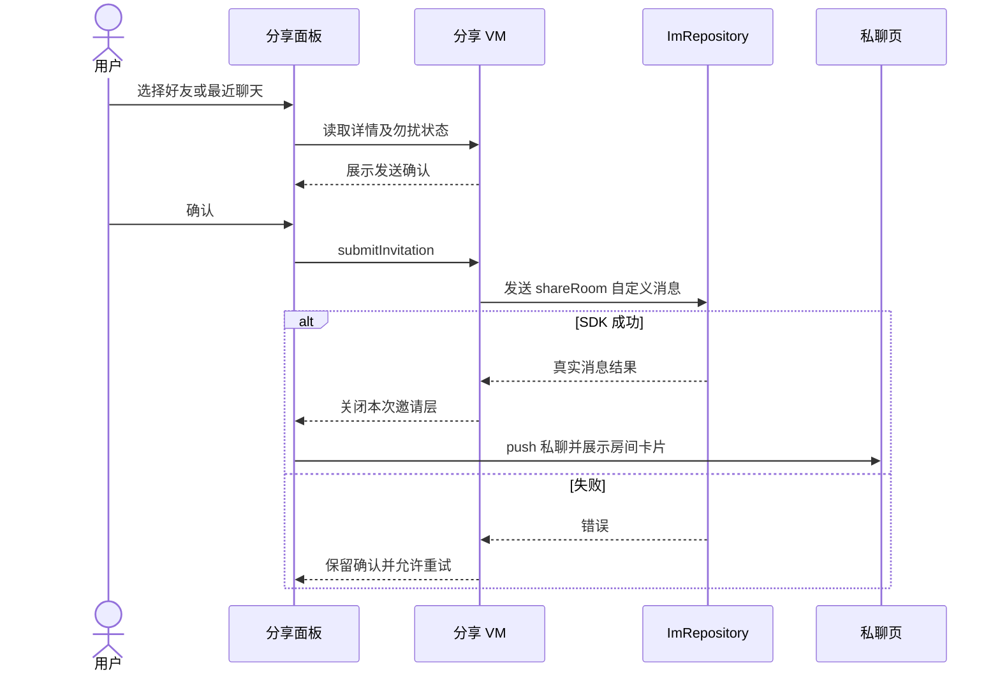

## 6. M02 举报

### 6.1 页面与校验

Nady 更多使用 `ReportPageRoute(int.parse(roomId), 1)`：**房间举报 reportType=1，reportId 为真实房间 ID**。迁移使用安全解析；非数字真实 ID 不能改用 roomNo，应显示无法提交并记录契约不匹配。

举报页包含原因单选、最多 200 字说明、最多 4 张截图、截图移除和提交。原因协议：1 色情、2 宗教、3 政治、4 违法、5 其他。原因至少一项；说明和截图按当前 Nady 为可选，不擅自加必填条件。

截图选择走平台权限/图片选择 Service：未授权给出可重试或去设置入口；用户取消不报提交错误；重复添加仍计总上限 4 张。预览与移除均在本表单内完成。

### 6.2 上传、提交和返回

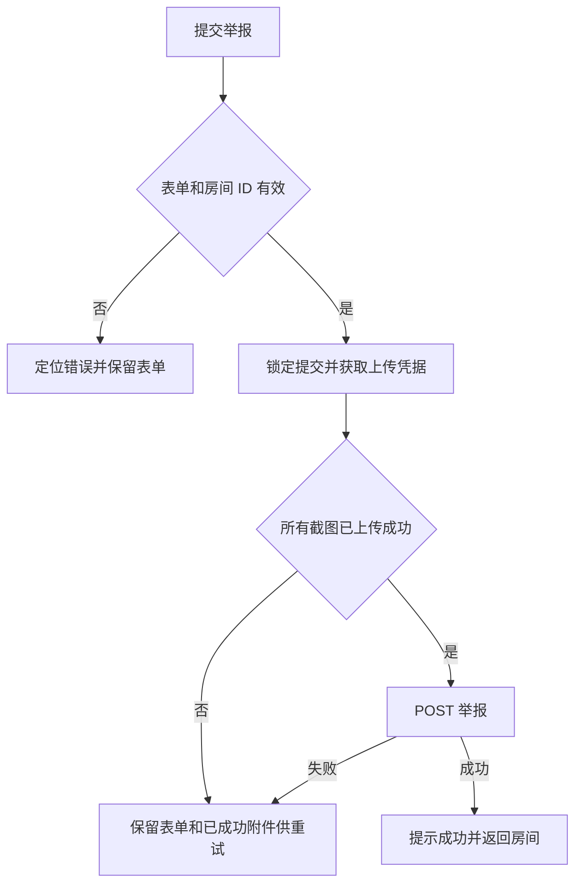

Nady 多图凭据：`GET /api/resource/header-upload-param/list?num=<数量>`。返回各项 `endpoint/accessKeyId/accessKeySecret/securityToken/bucket/path`，逐图上传 OSS 后将对象 path 放入 `photosList`；不是本地文件路径。已有 iSnow 上传凭据/签名代码可提取为附件 Repository/Service，不让举报 View 依赖登录 ViewModel，不创建第二套 Nady HTTP 客户端。

上传成功数量少于选图数量时不提交举报；保留可重试表单，并在会话不变且凭据有效时复用已成功的附件结果。空截图直接提交空列表。

`POST /api/report` 请求示例：

```json
{
  "reportType": 1,
  "reportId": 123,
  "categoriesList": [5],
  "description": "用户填写的说明",
  "photosList": ["uploaded/object/path.jpg"]
}
```

Nady 当前失败也会 `context.pop()`，本次明确修正：只有真实成功才提示成功并返回；失败保持表单、释放 loading、允许重试。页面主动返回不退房，晚到的上传/提交结果不得重新导航。

## 7. M03 音乐

### 7.1 复用边界和入口

iSnow 已有 `RoomMusicSheet`、`RoomMusicViewModel`、应用级 `RoomMusicRepository`、本地曲库、Agora 混音、播放器占用及事件处理。更多入口应复用这些能力，不能再做一套播放器。

完整过程：

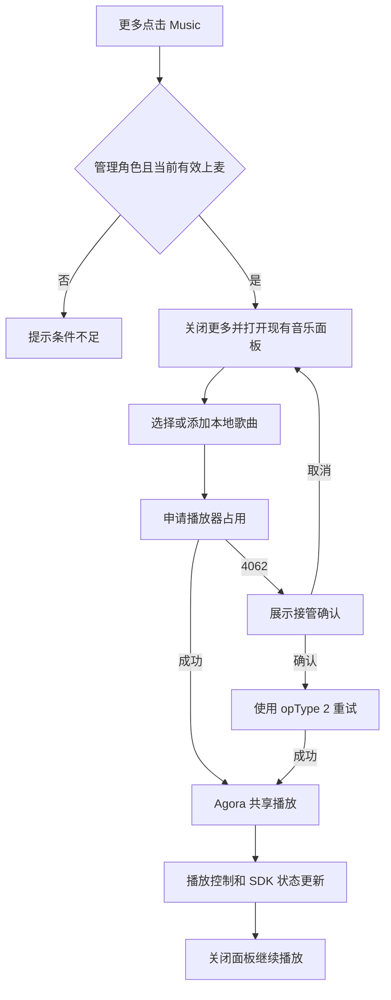

播放器控件完整保留：添加、删除、切歌、播放/暂停/停止、进度、音量、列表循环/单曲循环/随机模式，以及加载、空曲库、读取失败和接管确认状态。

### 7.2 契约和状态

- `POST /api/room/openPlayer`：`{roomId, opType:1}`；服务端 4062 先确认，确认后才 `opType:2`。
- `POST /api/room/closePlayer`：`{roomId}`；被别人强制接管时停止自己的混音，不能关闭对方占用。
- `POST /api/room/msg/push`：`event=RoomMusicPlaybackStatusEvent`，Nady 当前线上的状态常量是大写 `data=PLAYING/PAUSED/STOPPED/FAILED`；不擅自增加歌曲标题等服务端字段。iSnow 当前使用 `status.name` 发小写，与 Nady 存在差异，须在协议适配层映射，不能直接复用该错误大小写。
- `global:<uid>` 上的 `RoomClosePlayerEvent` 按现有解析器停止本地播放；保留原始 payload，不能自行假设其新 schema。
- Agora SDK 状态决定真实 Playing/Paused/Failed；闭麦不自动关闭音乐，也不能启动音乐时打开用户人声。
- 曲库按 UID 隔离，退出房间不删曲库；关闭面板、Keep、后台继续播放。下麦、被踢下麦、退出、切房和注销按既有规则停止混音/释放占用。

入站音乐状态按 Nady 同时兼容直接字符串以及 `{msg:...}`、`{status:...}`、`{data:...}` 包装，实际状态值以以上大写常量为准。文末既有音乐文档中的小写示意不得覆盖本次源码核验出的协议。

详细已有实现见文末音乐文档。新的更多、PK、宝箱或游戏页面不拥有播放器生命周期。

## 8. M04 魅力计数及详情

### 8.1 房间共享开关

房主/管理员看到计数入口；打开更多时查询 `GET /api/room/mic/charm/isEnable?roomId=...`，使用响应 `data` 的布尔值显示图标。

点击执行 `GET /api/room/mic/charm/updateStatus?roomId=...&enable=<目标 bool>`。该接口当前就是 GET，不能因它修改状态而在客户端改成 POST。成功时使用返回布尔 `data` 更新，不把 `false` 误判为请求失败。

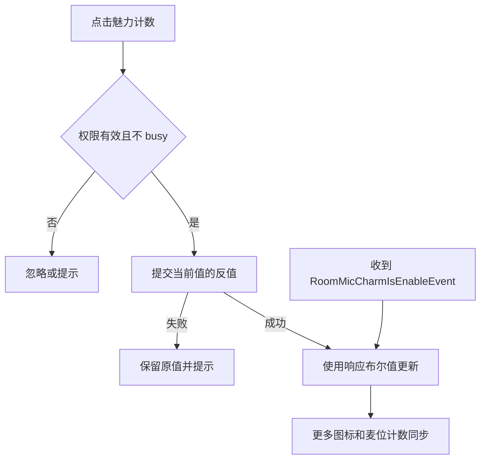

`RoomMicCharmIsEnableEvent` 的 payload 是布尔值。其他终端开关也必须同步，不能只存在更多 Sheet 的局部 VM。关闭计数只隐藏相应视觉，不关闭送礼、公屏、PK 计分或服务端统计。

### 8.2 魅力详情二级链路

启用后，麦位魅力入口可打开详情：`GET /api/room/mic/charm/rank?roomId=...&targetUid=...`。

返回 `CharmInfo`：`charmValue/myContributor/ratio/rule/contributors`；其中 `myContributor` 为本人的贡献数值，`rule` 为规则页URL，应显示“规则”入口并合并 language 参数跳转，不直接显示URL。贡献人项为 `uid/avatar/rule/nickName/charmValue`。显示当前目标用户魅力、我的贡献、比例/规则与贡献列表；空榜正常显示，不用“加载失败”替代。

贡献人头像打开既有个人主页；详情“送礼”打开现有房间礼物面板并明确传递目标 UID/用户信息，不能照搬 Nady 个别路径传空 `targetUID` 造成赠送目标错误。礼物扣币、连送和视觉反馈复用既有送礼逻辑。

详情加载失败保留重试；目标下麦后不得继续用旧麦位位置送给新占位用户。详情币种跟随第 11 节房间 `digitalCurrency`。

## 9. M05 声音开关

这是**本人收听房间声音**的开关，不是麦克风发布、房间全员禁言或音乐停止。

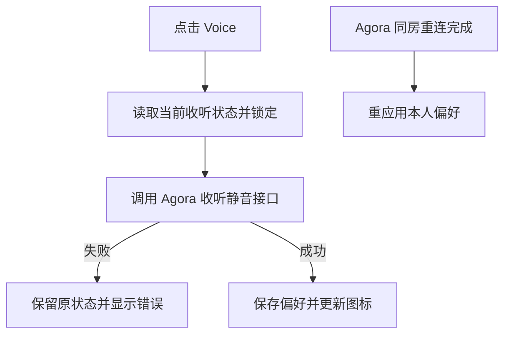

Nady 读取本地 key `self_setting_room_<roomId>_speaker_mute`，默认 false，并调用 speaker 与远端音频流静音。iSnow 复用当前 Agora manager 的 mute 能力，并核实人声和混音收听都能按预期静音；不改变本人麦位角色或 `mutedMicrophone`。

迁移需修正 Nady `mute()` 中将 `getBool(key, mute)` 当作写入的缺陷：使用真正的存储写入方法。目标偏好按 `uid + roomId` 隔离，避免切账号互相污染；此为本地存储修正，不改变后端契约。

只在 SDK 操作成功后提示“已开启/关闭收听”；SDK 失败释放 busy 并保持旧图标。Keep 保留偏好，Agora 重连后重应用；正常按钮切换不调用 `/api/room/outRoom`。

## 10. M06 动效设置

### 10.1 页面与持久化

关闭更多并打开设置 Sheet，显示六项开关：

| 协议/存储 key | 含义 | iSnow 接入位置 |
| --- | --- | --- |
| `all_effect` | 批量设置所有子项 | 设置页总开关 |
| `car_effect` | 座驾/进房车辆动效 | 车辆视觉层 |
| `gift_effect` | 小礼物相关视觉 | 小礼物/轨迹视觉通道，业务接收仍继续 |
| `gift_big_effect` | 大礼物动效 | SVGA/PAG/VAP 等全屏播放通道 |
| `sound_effect` | 麦位声波纹 | 麦位视觉层，不影响声音和音量事件 |
| `screen_top_effect` | 飘屏 | 顶部礼物/游戏/世界宝箱等受控飘屏通道 |

Nady 按 UID 建本地设置目录，各项默认 1/true；没有房间 HTTP 更新接口。iSnow 用现有本地存储能力实现按账号隔离，不需要为了照搬物理文件结构引入新的数据库。

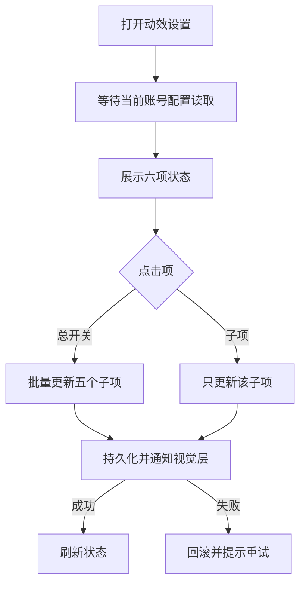

### 10.2 实际效果约束

- 不允许只保存开关却没有接到真实视觉层。
- 总开关操作写入全部子项；单项关闭后总开关展示为未全开，不出现总开关仍开而子项关闭的矛盾状态。
- 关闭视觉不停止礼物事件消费、公屏业务消息、金币刷新、PK 计分或宝箱领取状态。
- 禁用通道时清理或完成该通道待播放任务，避免播放器队列一直等待；重新启用只接受有效新任务，不回放已过期动画。
- 波纹开关仅作用于可视波纹；不能调用 Agora 静音。
- 账号配置加载完成前不把未加载误当“全部打开”并覆盖持久化值。退出登录切换配置订阅，旧账号异步结果不能写到新账号。
- 缺少座驾等视觉层时，该开关实现和通道接入必须列入迁移任务；不能因为 iSnow 尚无对应图层而标记已完成。

## 11. M07 魅力统计币种设置

该设置控制**房间魅力统计展示使用金币还是钻石**，不是兑换或支付设置。房主/管理员可进入；普通用户接收变化并更新房间 UI。

更多点击 Charm set → 关闭更多 → 读取当前房间 `digitalCurrency` → 打开二选一 Sheet：`1=金币`、`2=钻石`。

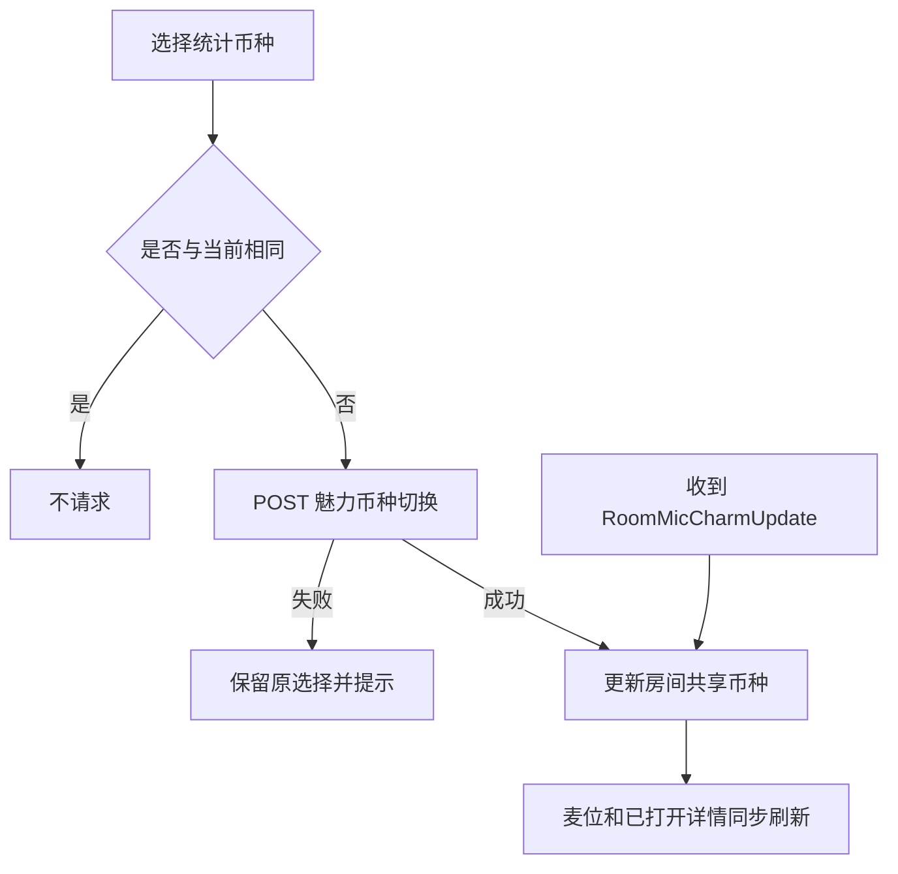

`POST /api/room/mic/charm/switch`：`{roomId, digitalCurrency:1|2}`，业务 code=200 才成功。`RoomMicCharmUpdate` payload 为整数币种，不是魅力数值或 `{digitalCurrency:...}` 对象。

Nady 初值来自进房响应的 `digitalCurrency`；iSnow 当前 `EnterRoomResp` 没有类型化暴露该字段，需要从真实进房 raw 解析并提升到房间状态。协议缺失/未知值显示未知并刷新，不能把枚举未知当成已保存的金币设置。

同步后重新显示/拉取对应币种的魅力数据。开关关闭和币种切换是独立状态；切换不自动开启魅力计数。退出清除房间共享币种，Keep 保留。

## 12. M08 房间模式、游戏区域与记录

### 12.1 实际启用依据

`GET /api/resource/function2?roomId=...` 返回：

```json
[
  {"type": 1, "list": [{"id": 1, "name": "配置名称", "position": 7}]},
  {"type": 2, "list": [{"id": 2, "name": "配置名称", "position": 2}]}
]
```

这是响应 `data` 示例；真实启用以当前响应为准。`FunctionResourceModel.type` 为模式类型，`list[].position` 表示具体生效触点，不能把 position 当模式值。

Nady `getRoomModelList()` 当前明确生成：

| 模式 | 更多入口条件 | 行为 |
| --- | --- | --- |
| Chat | 固定基础模式 | 关闭服务端大厅并恢复普通麦位 |
| Win，type=1 | function2 有 type=1 且 position=7 | 开启/恢复大厅记录区域 |
| Treasure，type=2 | function2 有 type=2 且 position=7 | 开启/恢复挖矿区域及快捷礼物 |
| 7/8/11/12 | iSnow/Nady 枚举存在，但当前更多未生成相同完整模式入口 | 不凭枚举接通；保留扩展值，文档标记当前无完整入口迁移依据 |

其他位置有独立用途：Nady 处理 `RoomLobbyStatusEvent` 校验 position=2；处理房间奖励校验 position=1；游戏飘屏部分检查对应类型 position=22。只命中 position=7 不代表自动获得其他展示权限。

保持现有 iSnow 面板容器、图标资源与主题；修正模式语义和配置可见性。当前 `_roomModeAsset` 的近似图标映射不能证明 KTV/Map 等业务已实现，Chat 也不能映射成 type=12。

### 12.2 模式状态机

至少区分：`serverOpen`、`lobbyType`、`localPanelVisible`、`panelMinimized`、`busy`；房间游戏区折叠和整个房间 Keep 是不同操作。

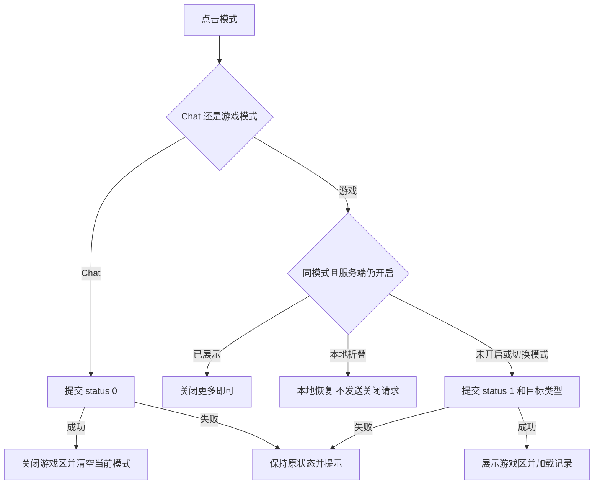

接口 `POST /api/lobby/open`：`{status:1|0, roomId, lobbyType}`。Chat 关闭分支 Nady 当前使用 `lobbyType:1` 兜底；保留其已验证契约，不发虚构的 Chat type。

点击已开启模式是恢复/保持展示，**不是切换开关关闭**。iSnow 当前 `open = !selected` 与 Nady 不一致，需要修正。只有 Chat 关闭或明确业务关闭动作发 status=0；游戏区本地折叠不关闭服务端模式。

`RoomLobbyStatusEvent` payload 为 `{status, lobbyType}`，缺省 lobbyType 在 Nady 为 1；全房同步面板状态。HTTP 结果晚于新的 Socket 状态时不能回滚较新的服务端状态，需取消过期结果或重新查询房间快照。

### 12.3 Win/Treasure 目标内容和二次点击

- Win 首次加载 `GET /api/lobby/lists?roomId=...`，项字段 `gameId/uid/avatar/nick/win/multiple/icon/gameUrl/countryCodes`。
- Treasure 加载 `GET /api/lobby/playTo/lists?roomId=...`，字段 `roomId/giftIocs/playTos`。`giftIocs` 拼写保持兼容；礼物项 `icon/giftId/price/defaultGiftNum`；记录项 `giftId/gameId/uid/avatar/nick/win/multiple/icon`。
- 游戏缩略图/带 gameUrl 的记录进入第 14 节专用游戏容器；无有效 URL 不跳空页。
- Treasure 快捷礼物复用现有礼物发送协调器：有有效麦位用户则送全部麦位，无麦位时按 Nady 送全房，使用接口提供的 giftId/price/defaultGiftNum、giftSource=1、comboCount=1。不得复制一套扣币和动画事件生成器。
- Treasure 获奖记录点击可打开礼物面板并选中该 giftId。普通礼物、背包和目标模式沿用既有礼物模型，不篡改服务端 sendType。
- 点击房间奖励卡槽恢复对应 lobbyType 的本地面板；是否允许展示仍检查服务端功能和既有审核/账号配置，不额外开服务端大厅。
- 本地折叠展示小入口；恢复后清理旧奖励播放队列，展示当前记录和新事件。

记录按 Nady 以 250 ms 间隔逐条插入初始列表，实时消息在头部插入；保留国家 `countryCodes` 过滤。当前截断代码存在索引风险，迁移保持“超过约 100 条裁回约 90 条”的有界意图，使用安全范围，不照搬错误 `removeRange`。

`RoomGameAwardEvent` 和 `RoomGameAwardEvent2` 分别更新 Win/Treasure 奖励展示及记录；同一事件不能被房间处理器和记录组件重复消费后重复插入。详细载荷见第 16 节。

## 13. M09 PK 全链路

### 13.1 设置页

管理角色点击 PK；已存在 `eventType=1/2` 的 PK 时提示正在进行，不重复开始。设置 Sheet 有 1V1 和多人 Tab、当前麦位用户、1V1 红蓝区域、多人全选、时长和开始按钮。

规则：1V1 恰好 2 个有效用户；多人至少 2 个有效用户。选择按 UID 跟踪，并在麦位变更后重新映射当前 `position`；用户离麦移出选择，新用户占旧位置不得自动成为选手。切换 Tab 清空旧选择。

时长以分钟提交，默认 3，可选 3/5/10，More 为 20/30/40/50/60。提交前再次验证管理权限、当前 PK 状态和当前选手。

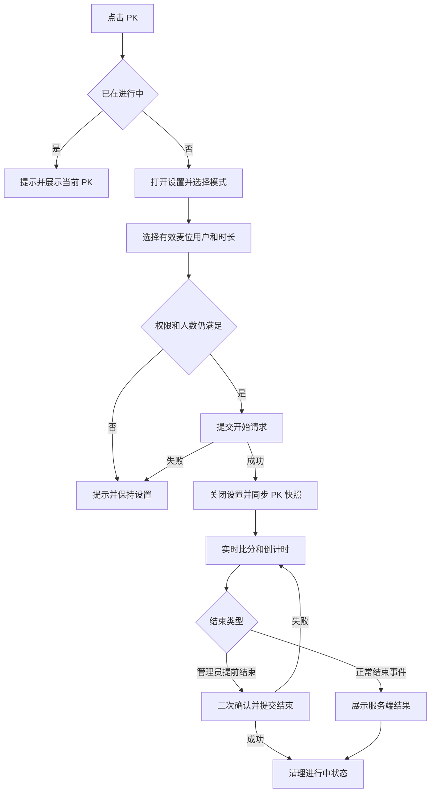

### 13.2 HTTP 契约

`POST /api/room/pk/begin` 示例：

```json
{
  "roomId": "123",
  "duration": 3,
  "pkUserList": [
    {"uid": 101, "identity": 1, "micIndex": 0},
    {"uid": 102, "identity": 2, "micIndex": 1},
    {"uid": 103, "identity": null, "micIndex": 2}
  ]
}
```

第三项仅用于多人示例；1V1 只发两个。Nady 依选择顺序给前两项 identity=1/2，其余 null；不要重命名 `pkUserList/micIndex`。

`GET /api/room/pk/info?roomId=...&pkId=<可选>` 获取当前/指定 PK；首次进入、Keep 恢复、重连和请求成功但缺事件时用快照校正。`POST /api/room/pk/over` body 为 `{roomId}`，必须用户确认后执行。

### 13.3 实时展示、结果和后续动作

`RoomPkInfoUpdate`：`eventType=0` 未开始、1 开始、2 更新、3 提前结束、4 正常结束。`pkInfo` 包含 `pkId/countdown/pkMap`；每个选手含 `userInfo/contributorList/pkScore/identity`。

- `countdown` 是**毫秒结束时间戳**；`duration` 是设置分钟，两者不能互换。按服务端结束时刻计算剩余时间，回前台重新校准，不累计丢失的 Timer tick。
- 1V1 红蓝用户和多人列表使用服务端 pkMap；显示比分、贡献人和收礼更新，不在客户端推算奖励或分数。
- 最后 30 秒显示 Nady 的氛围变化；时间到不自行制造正常结束奖励，刷新快照并等待服务端最终状态。
- 进行中支持 PK 区域本地折叠/展开；不结束服务端 PK，也不最小化整间房。
- 点击 PK 选手打开礼物面板，明确传当前选手 UID；礼物 HTTP 成功不直接更改 PK 分数，等服务器事件/快照。
- eventType=4 按服务端 pkMap 的结果顺序展示：Nady 首项分数大于 0 时播放赢家视觉；无正分时显示结果。保留 1V1/多人结果视图及 pkId，避免清空进行中状态时丢失结算资料。
- eventType=3 清理进行中状态，不伪造正常获胜；结束接口失败不能像 Nady 当前 `onTurnOff()` 一样无条件本地结束。
- 同一 pkId 的重复结束事件只展示一次；旧 PK 的更新不能复活已结束会话。无事件版本字段时按终态锁与快照校正，不自造后端序列号。

## 14. M10 至 M12 宝箱、动态工具和游戏

### 14.1 M10 幸运宝箱配置与发送

入口见权限矩阵。打开后刷新 `GET /api/redPacket/config?roomId=...`，页面包含 Room(type=0)/World(type=1)、金币档位、接收人数、倒计时、规则入口、余额/充值和发送按钮。

配置 `LuckyBagConfig`：`visible/rulesUrlEn/rulesUrlAr/room/world`；room/world 均为：

```json
{
  "configuration": [
    {"goldQuantiry": 1000, "numberOfRecipients": [5, 10, 20, 30]}
  ],
  "countdown": [60, 180, 300, 600]
}
```

数值仅示例；档位和人数必须来自服务端当前配置，倒计时单位为秒。切换档位重置人数到合法第一项；切换 Room/World 使用对应配置，不沿用越界索引。规则 URL 根据现有语言映射使用 En/Ar，其他语言没有对应字段时明确回退 En，不编造 `rulesUrlZh`。

Nady 内置 fallback 档位用于显示兜底，不代表服务器允许交易。迁移要求：配置加载失败可以展示错误/重试或只读缓存，但不得按示例档位直接发币。

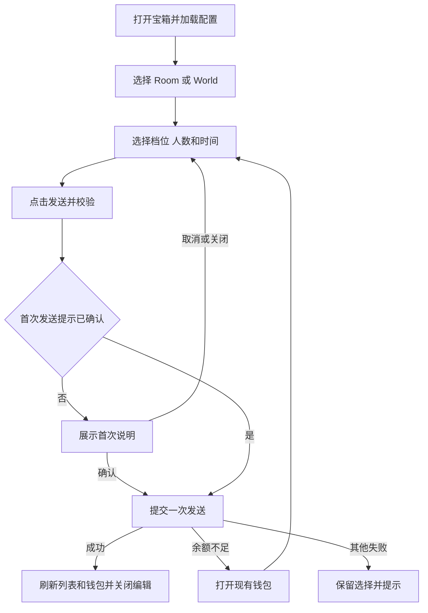

`POST /api/redPacket/push`：

```json
{
  "roomId": "123",
  "type": 0,
  "gold": 1000,
  "numberOfRecipients": 5,
  "countdown": 60
}
```

返回 `LuckyBagModel` 才视为成功；刷新宝箱列表和钱包真实余额，关闭发送面板。没有成功回执不本地扣币、不捏造宝箱 ID。超时结果不确定时先查列表/刷新余额再允许用户判断重试，不自动重复提交交易。

首次说明保留 Nady 体验但修正提交触发：只有明确确认才保存“已提示”并发送一次；取消、遮罩关闭、返回和 `onDismiss` 不发送，不能在按钮和 dismiss 两处分别调用提交。提示状态按 UID 隔离。

余额区和不足回调复用 `/wallet`。钱包返回后刷新余额并保持当前档位，不自动代用户再次发送。失败和取消保留原状态。规则页和钱包返回都不释放房间会话。

### 14.2 宝箱列表、开箱队列和结果

`GET /api/redPacket/list?roomId=...` 返回 `LuckyBagModel[]`，字段 `id/deadline/remainingTime/uid/avatar/nickName/gender/waveEffectUrl/staticAvatarFrameUrl`。

按 Nady 列表展示发送者和倒计时；当前每 2 秒更新剩余时长，结束进入开箱队列。迁移由服务端剩余时长校准本地 deadline，不依赖后台 Timer 一直运行；重复 Socket 刷新不能重复入队同一宝箱。

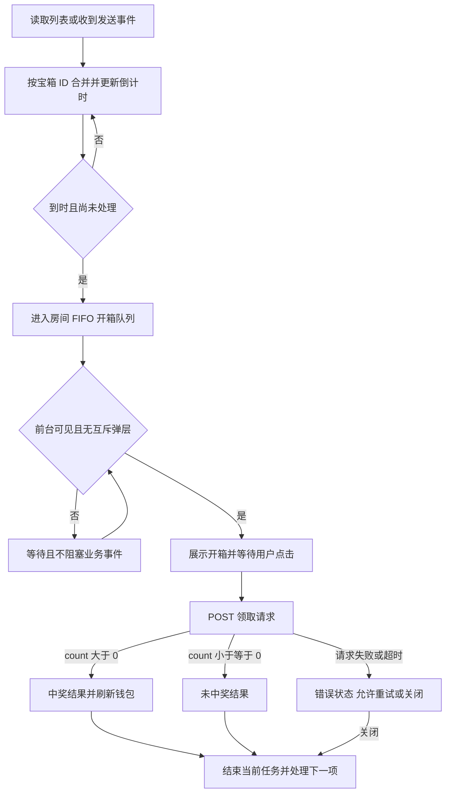

`POST /api/redPacket/grab` 仅发 `{luckyBagId}`，不额外添加猜测字段。响应 `LuckyBagResult` 含 `count/icon/uid/avatar/nickName/gender/waveEffectUrl/staticAvatarFrameUrl`。

- Nady 点击开箱后约 1750 ms 展示结果，约 3000 ms 关闭开箱层；iSnow 可沿用时序和现有动画资源，但延迟任务必须可取消并绑定当前宝箱/房间代次。
- count>0 显示中奖数量，count<=0 显示未中奖。网络失败/null **不是未中奖**，不伪造金额或结果。
- 当前队列必须在成功、未中奖、失败关闭、用户取消、资源失败和退房时都能释放；结果层关闭后只推进一次。
- 避免 Nady 以 roomId 共享一个开箱结果导致多个 ID 串结果；每次按 `luckyBagId + operationGeneration` 独立保存结果并禁重复领取。
- 有互斥送礼/充值/确认时暂停开箱视觉，不停止列表/公屏消费；block 必须在 finally 解除。Keep/后台仅保存待处理业务 ID，恢复先重拉列表，不重播历史领奖动画。

### 14.3 宝箱公屏、世界横幅与跨房

- `RoomScreenLuckyBagSendEvent`：发宝箱公屏，同时刷新当前列表。
- `RoomScreenLuckyBagReciveEvent`：收礼结果公屏，保留 Nady 的 `Recive` 拼写；不是新的金币结算指令。
- 两者 payload 经通用 `RoomScreenMsg` 处理，展示多语言内容及 `data.goldCount`；领取公屏链接可打开目标用户资料。
- `WorldLuckyBagEvent` 在 `room` 广播频道消费，载荷见第 16 节；受飘屏开关、前后台和现有账号/审核策略控制。
- 点击世界横幅按 Nady 先确认跳房；可进入动效设置关闭飘屏。取消不切房；确认且目标是不同房间才走统一旧房 Exit → 新房进入；同房仅恢复，不能重复 leave/join。
- `GET /api/redPacket/haveBox` 查询参数 `roomIds` 为列表，返回 `roomId/thereOne`，供跨房入口提示是否有宝箱；不能用它代替当前房间详细列表。
- `RoomLuckyBagSettleEvent` 在 Nady 定义了常量，但本轮全库核验未定位到实际订阅/消费。保留原始消息供诊断，标记待后端核验，不擅自把它当作客户端派奖触发器。

### 14.4 M11 动态工具和 M12 游戏入口分流

`POST /api/resource/banner` body 带 `position`、真实 `roomId`；Nady 还合并公共设备/语言参数，iSnow 由既有网络层/Repository 统一补充必要字段。

| position | 响应 | 入口和目标 |
| --- | --- | --- |
| 7 | `data.list` 的 AppBannerModel 项 | 基础工具追加项 → 普通 WebView |
| 5 | 同上 | Game 区 → 专用游戏容器 |

字段：`id/name/pic/routeUrl/startTime/endTime/seqNo/smallIcon/pichash/tagList/showTime/dailyDisplayLimit/routeType`。服务端返回有效顺序优先；无有效数据隐藏相应区块；两个 position 单独加载和报错，不能一个失败就清空另一个成功结果。

Nady 动态工具打开 `BrowserPageRoute(... hiddenAppBar:false)`；iSnow 当前统一 hiddenAppBar=true，需要按目标类型修正，保留正常返回入口。HOT/NEW 只取真实 tagList，不自造标签。

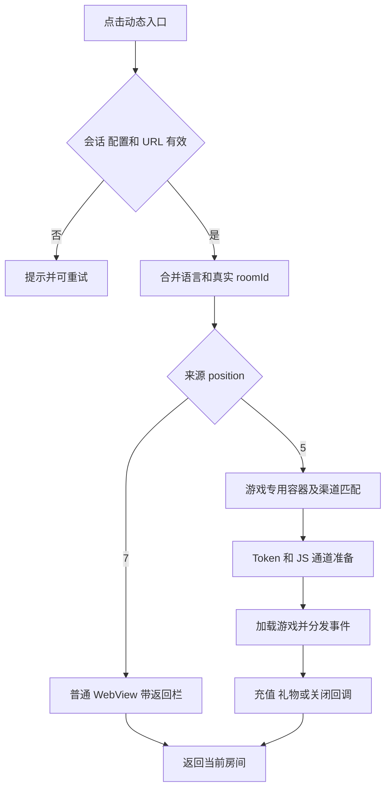

`routeUrl` 支持替换 `${roomId}`、`${language}`，再以 `Uri` 合并 query，保留原有参数和 fragment；相同 roomId/language 不重复追加。只对可识别且允许的网页/内部跳转处理，不因 `routeType` 枚举值未知就猜测一个新页面；Nady 当前两个入口的实际分流依据是 position 和调用路径。

### 14.5 游戏容器完整要求

现有普通 WebView 已有 `nadyBridge/apiCaller`，但尚不能代表完整游戏容器：

1. 同一会话只展示一个游戏；重复点击复用/忽略，不叠加多个 WebView 和充值弹层。不同游戏切换先释放旧游戏消费者，再创建新游戏实例，保留房间连接。
2. 识别已配置第三方游戏域名，调用 `GET /game/token`，默认 query 名 `token`、`uid`；Nady 此处 uid 传的是 **userNo 展示编号**，不是 IM/房间使用的账号 UID。
3. 渠道可覆盖 `tokenParamName/uidParamName/extParamName`。Nady Yomi 使用 `platAuthCode/platUserId/platPayload`；iSnow 自有域名和渠道列表待配置，不能把任意 URL 都当此渠道。
4. Token 获取失败，需鉴权的游戏展示错误重试。Nady 当前失败回退无 Token URL 可能形成白屏，作为修正项，不伪装已加载成功。
5. 普通工具不注入游戏 Token。网页主文档失败提供重试/关闭，子资源失败不无条件关闭整页；日志不输出 Token 或带密钥完整 URL。
6. 保留游戏 `webviewinfo` 尺寸行为：query 参数值为 JSON，读取其 `ratio`，可为正数或可解析的数字字符串，按 `屏幕宽度 × ratio` 得到容器高度；当前源码未使用其他尺寸字段。缺失使用安全区内可操作的默认大小，过大或非法比例做边界约束，不能让高度越界。
7. 生命周期调用 `window.appOnPause()`、`window.appOnResume()` 前检查函数存在；回前台同步实际钱包和必要房间快照。
8. 关闭时移除 JS channel、页面监听、相关游戏消息消费者和定时任务。晚到 Token、支付和请求回调不能访问已关闭 WebView。

### 14.6 JS 桥接字典

`nadyBridge` 输入外层：

```json
{
  "type": "apiCaller",
  "key": "h5-request-id",
  "data": {
    "method": "get",
    "url": "/relative-api-path",
    "param": {},
    "keys": "params"
  }
}
```

| JS channel | 输入判断 | 行为 |
| --- | --- | --- |
| `nadyBridge` | `type=openGiftPanel` | 关闭当前游戏，打开当前房间普通礼物面板 |
| `nadyBridge` | `type=openGiftPanelBackPack` | 关闭游戏，打开礼物面板背包分类 |
| `nadyBridge` | `type=apiCaller` | 复用 `WebBridgeViewModel/Repository`，按 method/keys 处理请求并回调 |
| `nadyBridge` | `type=close` | 只关闭当前游戏 |
| `nadyBridge` | `type=log` | 诊断日志 |
| `Flutter` | `name=newTppClose` | 关闭游戏 |
| `Flutter` | `name=clickRecharge` 或 `name=recharge` | 打开同一个钱包充值入口 |
| `yomi` | `type=closeGame` | 关闭游戏 |
| `yomi` | `type=insufficient` | 打开钱包 |
| `pay` | 渠道原有消息 | 打开钱包，不自行认定已支付 |
| `closeGame` | 渠道原有消息 | 关闭游戏 |

`apiCaller`：GET 的 param 放 query；POST 且 keys=data 放 body，keys=params 放 query；保持原有 language 注入。Nady 请求经现有认证网络层；不要让任意第三方绝对 URL 通过带 Nady 认证头的桥接路径。URL 来源与可调用范围使用已配置的当前环境/渠道校验。

成功回调 `window.nadyBridgeCallback("apiCaller", key, dataString)`，失败 `apiCallerError`，错误结构保持 `{message,response}`。dataString 为普通字符串或序列化 JSON 字符串；构建 JS 用 `jsonEncode` 编码参数，不能直接插入未转义文本。保留请求 key，保证一条请求只回调一次。

现有普通 WebView 的 `getAppInfo/paymentList/changeAppBar` 可继续复用；其中 `paymentList` 当前返回空列表，不得以此宣称完整支付渠道已配置。

### 14.7 充值与实时游戏消息

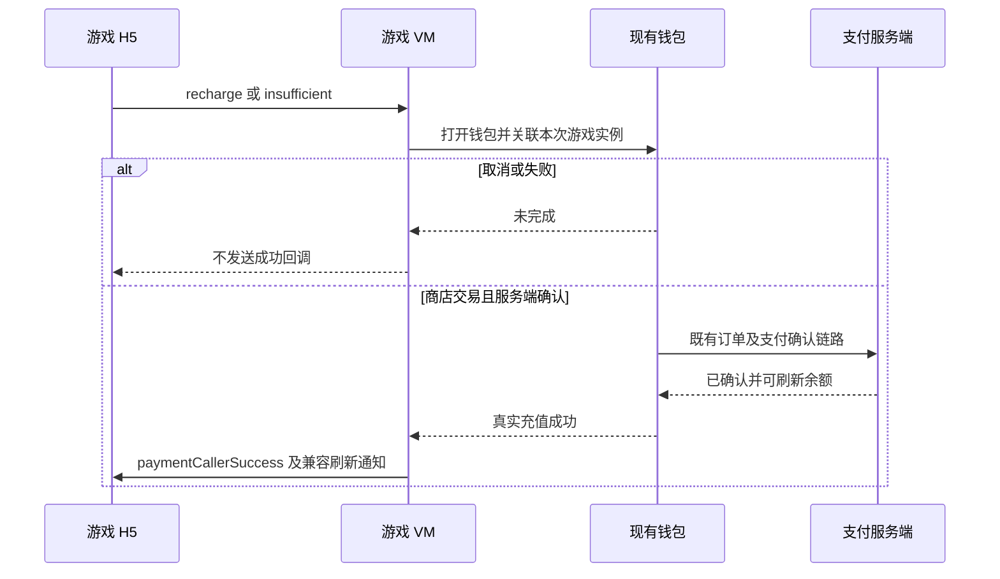

钱包复用现有商品、订单、商店购买和服务端确认；不新增房间充值接口。关闭钱包、点击购买或商店回调未验证均不等于金币到账。只有关联交易已被钱包服务端确认后，向仍有效的游戏实例发一次成功通知：

- `nadyBridgeCallback("paymentCallerSuccess", "", dataString)`，使用钱包确认的实际结果，不编造字段。
- 若函数存在，兼容调用 `window.HttpTool.NativeToJs('recharge')` 和 `window.rechargeSuccess()`。
- 取消、失败、恢复了其他历史交易或游戏已经关闭时，不能给当前游戏误发本次充值成功。

`FruitMachineEvent` 从 `game` 和 `game:<uid>` 频道进入，转为 `{event,payload}`，通过 `nadyBridgeCallback("longLinkCall", "", dataString)` 透传给有效游戏。payload 是第三方约定，客户端保留 JSON 类型，不猜测投注或结算字段。

游戏容器还展示 Nady 现有邀请房主提示和与当前 gameId 匹配的大奖提示挂件；邀请复用本章分享链路，大奖预告/结果继续按下一节实现，不生成假邀请或假活动。iSnow 尚未迁移的消费者属于关联开发项，使用真实配置控制显示。

### 14.8 游戏大奖挂件、预告和结果页

这是游戏容器可达的二级链路，不等于给更多新增 type=8 的模式按钮。Nady 使用 function2 的 `type=8 + position=17` 及现有审核策略控制活动事件消费。

iSnow 房间入口在右侧浮层、底栏上方，使用现有蓝湖 `AppAssets.lanhuRoomBigWinBanner` 图片和真实奖池金额（紧凑数字，缺失金额不补造 0），不放在音乐条与公屏之间的 `RoomToolsStrip` 横向工具行，不占用公屏高度，也不新增 More 模式。挂件只在当前有效房间、配置开启、有非空 `gameBigWinId` 和有效未结束状态时显示；按 Nady 房间挂件兼容有活动 ID 的 `status=0`，`1/2/3` 显示，`4`、空数据、缺少 ID 或未知状态隐藏。这里不同于游戏容器只匹配 `1/2/3` 的提示规则。

`showScreen` 只控制飘屏，不决定房间挂件是否显示。活动状态事件先更新挂件快照，再补拉详情；结束事件立即隐藏，即使详情刷新失败也不恢复旧挂件，已在途的旧 HTTP 快照不能覆盖新状态。只有同一活动 ID 可以继承旧详情字段，切换活动不复用旧奖池或游戏信息。Keep 和键盘弹出时隐藏房间挂件，恢复后使用当前活动状态；Exit 清理会话。本人中奖提示仍由独立的 `state.prize` 驱动，不随活动入口一起删除。

挂件点击沿用 `RoomBigWinPage` 及现有 Repository 请求，页面打开后刷新活动信息，按预热或开奖/展示状态渲染已有详情和轮次榜单；不新增接口或网络栈。图片已在房间资产目录和 manifest 中登记，所有新增视觉样式集中在 theme，禁止 Flutter Icon/Icons。

2026-10-27 验证：新增状态/页面测试 21 项，与房间工具、音乐、上下麦及 Keep/Exit 共 17 个测试文件联合回归 172 项通过；`flutter analyze --no-pub`、`git diff --check` 通过。320/375/430 宽度挂件截图已核对，覆盖不挤占公屏、外部点击不拦截、详情刷新/榜单接口、独立中奖提示、键盘及 Keep 恢复。使用模拟接口验证，未做真机联调。

点击挂件先请求 `GET /gameBigWin/getGameBigWinShow`，返回 `status/nextStatusTime/gameBigWinInfoVO`。状态 `0=未开始`、`1=预热`、`2=开奖`、`3=展示`、`4=结束`：

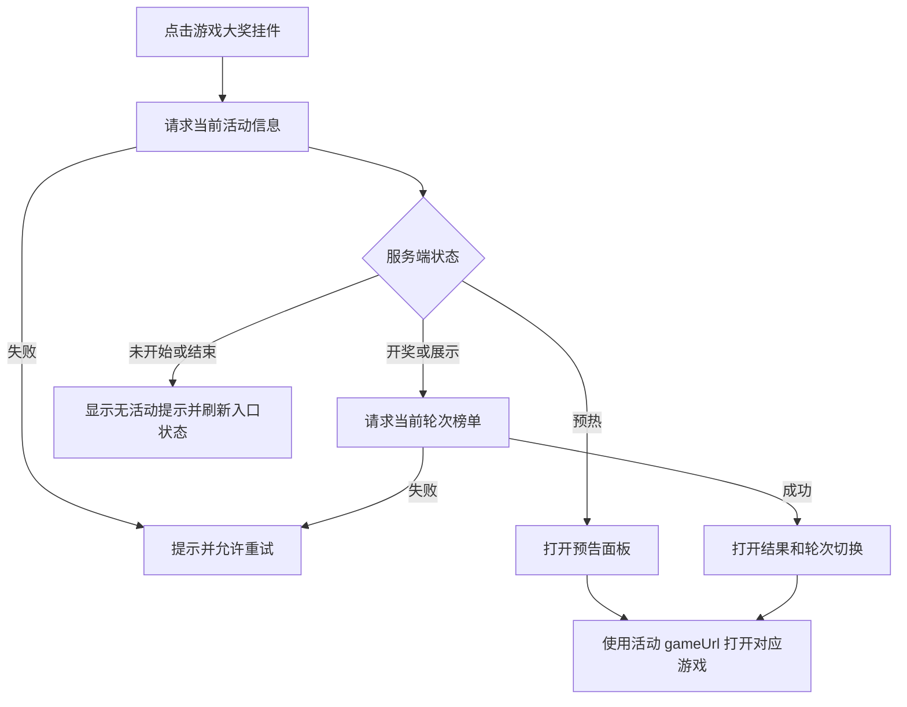

`gameBigWinInfoVO` 字段为 `gameBigWinId/gameId/gameType/gameUrl/gameName/gameIcon/bigWinTotalCoins/bigWinUsers/afterRound/afterMinutes/roundWinCoins/winRoundCount/curRound/nextStatusTime`。预告显示真实游戏、奖池及服务端触发信息；不在客户端计算开奖或中奖名单。

榜单使用 `POST /gameBigWin/getGameBigWinRank`，body 为 `{gameBigWinId, round}`。返回 `winUserList` 和 `bigWinUserVO`；用户项为 `avatar/nick/gameWinCoins/bigWinCoins/orderNum`。展示当前轮次结果，上一轮/下一轮范围为 `1..winRoundCount`，异步切轮以最后请求的轮次为准，空榜与网络失败分别展示。

预告/结果中的进入游戏按钮使用活动 `gameUrl`，复用专用游戏容器。当前已有房间时保持原会话；若从跨房提示选择了不同房间，仍须用户确认并通过统一切房流程，不能无提示随机切换房间。

`RoomLobbyBigWinStatusEvent` 来自 `global_lobby`；`RoomLobbyBigWinPrizeEvent` 来自 `global:<uid>`。二者使用 `RoomLobbyBigWinPushModel`：

```text
gameBigWinId?, gameId?, gameUrl?, gameName?, gameIcon?,
bigWinTotalCoins?, userWinCoins?, winRoundCount?, status?, curRound?, showScreen?
```

游戏容器先从 URL 的 `gameId` 或渠道 ext 参数中的 JSON `gameId` 定位当前游戏，仅在匹配且状态为1/2/3时显示对应提示；`showScreen=true` 时按既有飘屏控制展示广播。中奖提示来自 `userWinCoins`，最终钱包仍刷新服务端数据。

Nady 在游戏打开、旧状态为开奖且已有用户中奖金额的特定情况下，延迟15秒应用下一状态。迁移保留该展示节奏，但延迟绑定活动ID、轮次和游戏实例，期间收到更新/退出要取消旧任务，不能覆盖较新的状态。

## 15. HTTP 契约总表

除明确的查询参数外，下表参数均为 JSON body。成功 envelope 按 Nady `code/message/timestamp/traceId/data` 及 iSnow `NadyServerResponse` 处理；业务 code=200 与 HTTP 200 不是同一概念。不要把 bool false、空列表和请求失败合并为一个状态。

| 方法 | 路径 | 参数 | data/用途 |
| --- | --- | --- | --- |
| POST | `/api/resource/banner` | position=5/7，roomId，必要公共参数 | `{total,list:AppBannerModel[]}` |
| GET | `/api/resource/function2` | query roomId | `FunctionResourceModel[]` |
| POST | `/api/lobby/open` | roomId,status,lobbyType | 成功回执 |
| GET | `/api/lobby/lists` | query roomId | Win 记录列表 |
| GET | `/api/lobby/playTo/lists` | query roomId | `{roomId,giftIocs,playTos}` |
| GET | `/api/invite/materials` | query appScene,sub-scene,language | 素材列表 |
| GET | `/api/invite/info` | 无本业务额外字段 | 邀请码等现有邀请资料 |
| POST | `/api/share/short-links/batch` | shortBaseUrl,originalShareUrls | `{shortUrl,expireAt}[]` |
| POST | `/api/activity/component/share-report` | `{}`，外部分享触发时非阻塞上报 | bool；不是实际送达凭证 |
| POST | `/api/user/follow/friends` | pageNum,pageSize,targetUid,searchKey | 好友分页结果 |
| GET | `/api/user/homepage/get` | query targetUid | 接收人主页资料/VIP 等 |
| GET | `/api/vip/setting` | query uid | 含 noDisturb.open 的设置 |
| GET | `/api/resource/header-upload-param/list` | query num | 多图上传凭据列表 |
| POST | `/api/report` | reportType,reportId,categoriesList,description,photosList | 成功回执 |
| POST | `/api/room/openPlayer` | roomId,opType | 占用/接管结果；4062 冲突 |
| POST | `/api/room/closePlayer` | roomId | 释放播放器占用 |
| POST | `/api/room/msg/push` | roomId,event,data | 复用音乐状态/房间消息链路 |
| GET | `/api/room/mic/charm/isEnable` | query roomId | bool |
| GET | `/api/room/mic/charm/updateStatus` | query roomId,enable | bool |
| GET | `/api/room/mic/charm/rank` | query roomId,targetUid | CharmInfo |
| POST | `/api/room/mic/charm/switch` | roomId,digitalCurrency | 成功回执 |
| POST | `/api/room/pk/begin` | roomId,duration,pkUserList | 开始回执 |
| POST | `/api/room/pk/over` | roomId | 结束回执 |
| GET | `/api/room/pk/info` | query roomId,pkId 可选 | PkModel |
| GET | `/api/redPacket/config` | query roomId | LuckyBagConfig |
| POST | `/api/redPacket/push` | roomId,type,gold,numberOfRecipients,countdown | LuckyBagModel |
| GET | `/api/redPacket/list` | query roomId | LuckyBagModel[] |
| POST | `/api/redPacket/grab` | luckyBagId | LuckyBagResult |
| GET | `/api/redPacket/haveBox` | query roomIds 列表 | `{roomId,thereOne}[]` |
| GET | `/game/token` | 无本业务额外字段 | 游戏 Token 字符串 |
| GET | `/gameBigWin/getGameBigWinShow` | 无本业务额外字段 | 当前大奖状态及 gameBigWinInfoVO |
| POST | `/gameBigWin/getGameBigWinRank` | gameBigWinId,round | `{winUserList,bigWinUserVO}` |

`/api/activity/component/share-report` 经当前 Nady 分享 View 核验，在用户触发外部分享时调用；按第5.2节作为非阻塞触发上报，不能当作“实际送达”的必需交易接口。腾讯 IM 自定义消息和 OSS 文件上传分别遵守各自 SDK/存储协议，不是上述 HTTP envelope。

## 16. Socket、IM 与关键数据结构

### 16.1 外层与频道

沿用 Nady `LongLinkMsg` 和 iSnow `RoomSocketMessage`：

```json
{
  "event": "RoomLobbyStatusEvent",
  "payload": {"status": 1, "lobbyType": 1},
  "timestamp": 1792195200000,
  "toType": "<服务端投递类型>",
  "ids": null,
  "msgId": "<服务端消息 ID>",
  "from": null
}
```

频道是传输上下文，iSnow 将其放 `RoomSocketMessage.channel`，不要强行写回外层协议。区分账号 `uid`、展示 `userNo`、房间 `roomId`、展示 `roomNo`，全程不互换。

| 频道 | 用途 | 生命周期 |
| --- | --- | --- |
| `room:<roomId>` | 当前房间状态、PK、魅力、模式、宝箱公屏等 | 房间会话保持；Exit 取消 |
| `room` | 房间全服广播，例如世界宝箱和部分横幅 | 复用现有广播订阅，跨频道去重 |
| `global:<uid>` | 本人的播放器等指令 | 复用既有音乐相关订阅 |
| `global_lobby` | 游戏大奖公共状态 | 活动能力启用时复用，按消费者管理 |
| `game` | 游戏公共实时消息 | 配置/游戏能力需要时复用订阅 |
| `game:<uid>` | 游戏用户实时消息 | 使用账号 UID，不是游戏 URL 的 userNo |

新增 game 频道必须复用当前 `AppSocketManager` 及现有频道 Token 获取机制；按消费者引用管理订阅，不能创建另一条 Centrifuge 连接或退出游戏时把房间 Socket 断开。

### 16.2 事件字典

| 原始事件名 | payload | 处理和结果 |
| --- | --- | --- |
| `RoomIdentityUpdateEvent` | `{uid,roomIdentity,authorityNick}` | 本人身份映射1000/2000，刷新权限；普通用户不得继续提交管理操作 |
| `RoomMicUpdateEvent` | 复用当前麦位解析结构 | 同步当前用户/麦位，移除 PK 失效选择，核验音乐权限 |
| `RoomMicCharmIsEnableEvent` | bool | 更新房间计数可见状态 |
| `RoomMicCharmUpdate` | int：1 或 2 | 更新统计币种，刷新单位和详情 |
| `RoomPkInfoUpdate` | PkModel | 按 eventType 更新、结算或结束 |
| `RoomLobbyStatusEvent` | `{status:int,lobbyType:int}` | 按已配置类型更新服务端模式状态 |
| `RoomGameAwardEvent` | RoomGameAwardModel；记录消费者还读取对应记录字段 | Win 奖励和记录更新，客户端 lane type=1 |
| `RoomGameAwardEvent2` | 同上 | Treasure 奖励和记录更新，客户端 lane type=2 |
| `RoomScreenLuckyBagSendEvent` | 通用 RoomScreenMsg | 公屏显示并刷新宝箱列表 |
| `RoomScreenLuckyBagReciveEvent` | 通用 RoomScreenMsg，含领取显示数据 | 公屏展示中奖者及 data.goldCount，不在此本地派奖 |
| `WorldLuckyBagEvent` | LuckBagBannerPayload | 世界横幅及确认跳房 |
| `RoomLuckyBagSettleEvent` | 当前消费结构无证据 | 已定义未见消费；记录待联调，不推断结算 |
| `RoomMusicPlaybackStatusEvent` | 既有状态协议 | 复用已完成音乐逻辑，出站 data 字符串见第7节 |
| `RoomClosePlayerEvent` | 复用既有音乐解析协议 | 停止被接管的本地播放器 |
| `FruitMachineEvent` | 第三方游戏原始 JSON | 转发 `{event,payload}` 至 H5 longLinkCall |
| `RoomLobbyBigWinStatusEvent` | RoomLobbyBigWinPushModel | 更新当前活动阶段，按showScreen决定提示 |
| `RoomLobbyBigWinPrizeEvent` | RoomLobbyBigWinPushModel | 更新本人中奖展示并刷新实际余额 |

结构未确认的事件不编造 JSON。对 `RoomGameAwardEvent` 两种消费者：当前 Nady 同一 payload 既交给奖励模型也交给记录模型，其字段集合并不完全相同；iSnow 保留 raw 并分别解析所需字段，不假设两个模型可以直接互相序列化替代。

### 16.3 PkModel

```json
{
  "eventType": 2,
  "pkInfo": {
    "pkId": "pk-example",
    "countdown": 1792195500000,
    "pkMap": [
      {
        "userInfo": {"uid": 101, "nick": "示例用户", "avatar": ""},
        "contributorList": [],
        "pkScore": 1200,
        "identity": 1
      }
    ]
  }
}
```

示例只说明字段；业务活动至少 2 个有效选手，`BaseUserInfo` 实际完整结构沿用现有用户模型。pkInfo 可空；未开始/结束不能强解空对象。对 pkId 做归属检查。

### 16.4 RoomGameAwardModel 与记录

```text
奖励：userBaseInfo?, winAmount?, multiple?, duration?, lobbyType?, gift?, icon?, id?
Win记录：gameId?, uid?, avatar?, nick?, win?, multiple?, icon?, gameUrl?, countryCodes?
Treasure记录：giftId?, gameId?, uid?, avatar?, nick?, win?, multiple?, icon?
```

`duration` 在奖励视觉中作秒使用，Nady 无值时默认 3 秒；不可与 PK duration 的分钟混用。奖励事件本身不意味着当前用户余额增加，须刷新真实钱包/服务端状态。

### 16.5 宝箱公屏与世界横幅

通用 RoomScreenMsg 字段为 `from?/msg/event/msgID?/eventId?/status?/targetUid?/data`，外层 msgId 注入本地消息 ID。Nady 对特定 `toType/ids` 做定向显示，迁移保留现有投递过滤规则。

发送/领取公屏使用 msg 与 data 中已有多语言展示，不猜测新的 bagId 字段；需要当前列表时请求 list。领取展示的金额位于 `data.goldCount`，不等于领取接口返回的 count 字段名。

```json
{
  "userBaseInfo": {"uid": 101, "nick": "示例用户", "avatar": ""},
  "goldCount": 1000,
  "desc": "服务端文案",
  "descAr": "服务端另一语言文案",
  "icon": "<配置图标地址>",
  "roomId": "123",
  "effectUrl": "<横幅资源地址>",
  "upperEffect": "<前景资源地址>"
}
```

以上为 WorldLuckyBagEvent 的 LuckBagBannerPayload。动画资源失败应降级静态可用横幅或跳过该视觉并释放队列，不阻塞房间公屏和其他功能。具体降级为迁移修正，不改变事件。

### 16.6 防重、排序和回流

同一外层 msgId 在同一业务 lane 去重，保留原始大小写；`Recive`、`goldQuantiry`、`giftIocs` 均保留线上的拼写。重复结束事件不重复弹结果，重复发送事件不重复排宝箱。

payload 按事件支持 Map/bool/int/String，遇到字符串 JSON 只做有界解析，不把字符串中任意内容当作对象。坏消息记录 event/channel/msgId 后丢弃该条，不终止整个消息流。

HTTP 在提交完成后更新确认结果，Socket 表示共享事实；两者不会各创建一个重复动画。返回前台/重连用快照修复，不能用到达时间推断服务器绝对顺序。没有后端版本信息的冲突执行重新查询，不添加自创字段。

## 17. 必须修正的差异与缺陷

下列修正已获需求确认；不得以“完全复刻”为理由保留故障。

| ID | 源码观察 | iSnow 要求 | 对应测试 |
| --- | --- | --- | --- |
| D01 | iSnow 多个更多入口仍为 actionPending | 已启用入口均有真实目标与业务闭环 | W01-W12 |
| D02 | iSnow Party 区整体限制管理角色 | PK 和宝箱分别算权限，普通用户按 visible 展示宝箱 | U02/W02 |
| D03 | iSnow 六模式枚举固定生成，Chat 与 mapSocial 混淆风险 | 真实 function2 驱动，Chat 独立语义，未知模式不启用 | U03/U13 |
| D04 | iSnow 已选模式点击使用 !selected | Nady 同模式恢复而非关服，Chat 才关闭 | U13/W08 |
| D05 | iSnow position5/7 共用普通 WebView 且隐藏标题栏 | 普通工具和游戏分容器，普通工具保留返回栏 | W11/W12 |
| D06 | Nady 声音偏好更新调用 getBool | 真正写入，按账号/房间隔离，SDK失败不假成功 | U08 |
| D07 | Nady 部分动效值在配置未就绪时直接读 | 等待加载、默认值明确、账号代次隔离，子项/总开关一致 | U09 |
| D08 | Nady 魅力 status 将失败和 false 合并风险 | envelope失败与成功data=false区分，失败保留旧状态 | U10 |
| D09 | Nady 举报失败也 Pop | 成功返回、失败留表单重试，上传不全不提交 | U07/W04 |
| D10 | Nady 分享在链式 then 后关闭多层且未充分核验结果 | 只有真实 IM 成功才关自己弹层并导航 | U05/W03 |
| D11 | Nady 宝箱首次提示 onDismiss 会发起发送 | 仅明确确认一次，取消/关闭零交易 | U16/W10 |
| D12 | Nady 开箱延迟回调/队列可能在失败时不推进 | 按bagId/会话代次，取消计时器，所有结束路径释放 | U17/U18 |
| D13 | Nady PK 提前结束无条件清本地状态 | 结束请求失败保持进行中并刷新，禁止假结束 | U15 |
| D14 | Nady 多处全局 dismiss | 作用域弹层，不误关钱包/退出确认/下一任务 | W13 |
| D15 | Nady 手工拼接URL/JS字符串，Token失败回退空鉴权页 | Uri参数合并、JS编码、鉴权失败可重试 | U19/U20 |
| D16 | Nady 记录裁剪范围与刷新插入索引可能失效 | 有界安全裁剪，刷新取消旧Timer并重置索引 | U14 |
| D17 | Nady 部分日志/界面成功状态可先于真实回执 | 交易、SDK、IM和页面打开分别按真实结果反馈 | U21/E04 |
| D18 | Nady 房间详情邀请包含完整 roomPasswd | 邀请保留兼容字段但密码置空，进入仍校验锁房 | U06 |
| D19 | Nady 身份事件1000/2000不同于iSnow进房数字枚举 | 为事件单独映射并撤销已打开表单的管理提交能力 | U02 |
| D20 | iSnow音乐当前发status.name小写，Nady常量为大写 | 映射PLAYING/PAUSED/STOPPED/FAILED；兼容Nady入站包装结构 | U12/U24 |

## 18. iSnow 接入配置与证据缺口

| 配置/缺口 | 当前情况 | 落地要求 |
| --- | --- | --- |
| 邀请品牌、落地域名、Deep Link/Universal Link | 已明确允许沿用 Nady 当前环境，专属回房未接入 | 默认当前API域名 `/h5/invite` 并保留素材协议；可配置覆盖，外部点击回房仍为独立接入项 |
| 外部分享渠道 | 本轮按参考截图恢复九渠道 | 复用 url_launcher 启动 Nady Scheme/网页，Others 走 share_plus；失败仅提示，不自动降级，不报送达成功 |
| 第三方游戏域名/渠道参数 | Nady 有 thirdGameList/channelParamConfigs；iSnow 未提供专属值 | 按环境配置，保留默认及 Yomi 参数适配，真实渠道需联调 |
| 游戏 Token/用户映射 | 已确认 Nady接口与userNo用法 | 验证 iSnow 账号在同后端/渠道中是否有映射；缺失显示不可用并记录 |
| H5 页面和内部业务 | 非 Flutter 源码的一部分 | 文档定义容器与桥接；不在 Flutter 模拟 H5 投注/结算 |
| 模式7/8/11/12更多入口 | 枚举存在，当前菜单未生成对应完整链路 | 保留扩展值，不作为本次已启用可用入口；新配置出现时先补源码/产品依据 |
| 宝箱结算事件 | RoomLuckyBagSettleEvent 只有常量证据 | 获取真实payload/消费约定后补充，不用作派奖 |
| 活动/大奖挂件 | Nady 游戏容器有关联依赖 | 按14.8补齐预告、轮次结果和两类事件消费者；真实配置未启用时不展示，不用假数据占位上线 |
| 本地动效资源 | Nady有SVGA/PAG/VAP等 | 经资源映射与缓存复用，放现有资源目录并记录来源；缺图按iSnow资源政策处理 |
| 新页面视觉 | 仅确认采用iSnow主题 | 复用集中式token和现有蓝湖图；缺图用现有红色缺省图及语义，不使用Flutter内置Icon代替 |

实现中保持 iSnow 的 `docs/mvvm_architecture.md`、`docs/ui_theme_guidelines.md` 和房间资源政策。新增文案加入当前本地化系统；Nady 只提供 En/Ar 的服务端字段按明确回退处理，不为其他语言虚构字段。

## 19. 实施顺序与接口边界

### 19.1 推荐交付次序

| 阶段 | 工作 | 完成条件 |
| --- | --- | --- |
| 1 | 会话/导航守卫、更多权限/配置、独立加载状态 | 所有入口有准确可见性，异步不串房 |
| 2 | 声音、动效、魅力计数/币种与详情 | 开关真正影响对应通道，跨端事件同步 |
| 3 | 分享、举报 | 外部/IM分享、收件卡片、上传和失败回流闭环 |
| 4 | 音乐复用核验、Chat/Win/Treasure | 无重复播放器；模式状态机和记录可用 |
| 5 | PK、宝箱 | 设置、实时状态、终态、队列和钱包联动可验收 |
| 6 | 动态工具/游戏容器及渠道配置 | URL、桥接、实时、充值和生命周期全部通过 |
| 7 | 回归与真机 | 第20节关键测试通过，并记录外部配置限制 |

这些是实施顺序，不是裁减本次需求。所有已启用入口均属于最终交付范围；每阶段完成不能用未实现 Toast 作为下一层页面。

### 19.2 建议状态和接口

保留现有公共管理器接口。以下为后续开发建议的**客户端职责接口**，不表示当前已经实现，不新增同名后端 API：

```text
More VM: loadConfiguration(), resolveAction(toolId), refreshCapabilities()
Sharing: loadMaterials(language), loadRecipients(), sendRoomInvitation(uid)
Report: add/removeAttachment(), uploadAttachments(), submitReport()
Effects: loadForUser(uid), setAll(bool), setChannel(channel,bool)
Charm: loadStatus(), setVisible(bool), setCurrency(1|2), loadRank(targetUid)
Lobby: loadCapabilities(), selectMode(type), showPanel(), minimizePanel(), closeLobby()
PK: loadSnapshot(), selectUser(uid), begin(), confirmEnd(), applyEvent()
LuckyBox: loadConfig/list(), send(), enqueue(id), grab(id), finishCurrent()
Game: open(config), handleBridge(), requestRecharge(), forwardEvent(), close()
```

开关/提交 API 返回有类型的成功/失败与实际 data，不用一个 bool 同时表示“业务值为false”和“请求失败”。VM 对外暴露 loading/error/content/submitting，View 负责按结果执行一次导航。

房间共享开关、PK、模式、宝箱事件和必要队列的生命周期不能绑定更多 Sheet 的 autoDispose VM；更多关闭后共享消费者继续工作。账号设置/素材缓存和曲库是账号级，退出房间不清除；各弹窗本地输入和视觉控制器关闭即释放。

## 20. 测试矩阵与验收

本次仅产出文档，下表是后续实现必须新增/扩展的测试要求，不表示已经执行。复用当前 fake RoomRepository、Socket、Agora 和钱包/IM 边界；测试不访问真实支付或自动发币。

### 20.1 单元测试与协议测试

| ID | 场景 | 关键断言 |
| --- | --- | --- |
| U01 | canonicalRoomId与route alias不同、退出再进同ID | 所有请求真实ID；旧代次回调不写新会话 |
| U02 | audience/manager/owner及身份实时撤销 | 宝箱visible例外正确；1000/2000映射；越权零提交 |
| U03 | function2不同type/position、未知模式 | 只启用有依据入口，Chat不映射12；不同position独立 |
| U04 | 素材缓存/语言切换/短链失败 | 同语言合并请求；旧语言不覆盖；短链降级真实长链 |
| U05 | IM邀请确认/取消/勿扰/SDK失败 | 自定义消息shape正确；非确认不发送；失败不跳私聊 |
| U06 | 收到shareRoom、锁房、已在同房、异房 | payload字符串正确解析，密码不随分享泄露；不绕过进房校验 |
| U07 | 举报原因/说明/0至4图/部分上传失败 | 未选原因不提交；200字/4图边界；失败保留附件和输入 |
| U08 | Agora收听切换失败、重连、切账号 | SDK成功再写偏好；不改变人声；偏好隔离且重应用 |
| U09 | 动效默认值、加载失败、总开关/子项 | 五子项批量更新；队列清理；业务事件不因视觉关闭丢失 |
| U10 | charm查询/切换成功data=false与异常 | false是有效结果，错误不覆盖旧值 |
| U11 | 金币/钻石切换和RoomMicCharmUpdate | int payload正确，未知值不假保存；详情单位一致 |
| U12 | 音乐上麦/占用4062/接管取消 | 复用已有测试；无确认不强抢，面板关闭继续播放 |
| U13 | 模式已开/折叠/换模式/Chat关闭 | 同模式不发status0；HTTP与Socket竞态不回滚新状态 |
| U14 | 记录刷新、250ms插入、超100条、country过滤 | Timer可取消；索引有效；不会重复插入同事件 |
| U15 | PK选人变动、2人/多人、过期事件、结束失败 | UID不串位；duration分钟；失败不假结束；结果仅一次 |
| U16 | 宝箱首次发送确认/取消/dismiss/双击 | 确认一次请求；取消零请求；不越服务端档位 |
| U17 | 多宝箱到时/重复事件/block/失败关闭 | FIFO不死锁，按ID防重，结果不串ID |
| U18 | 开箱count>0、<=0、null、超时、退出 | null不当输；实际结果刷新钱包；晚到回调丢弃 |
| U19 | URL已有query/fragment/占位符/重复参数 | Uri合并不丢原参数；错误URL不跳页；Token不串渠道 |
| U20 | JS坏JSON/引号/汉字/API失败/关闭后响应 | params key保持，安全编码，每请求回调一次，无已销毁访问 |
| U21 | 充值取消/失败/未确认/历史交易/有效成功 | 只有关联且确认成功通知一次H5；钱包失败不加金币 |
| U22 | room与game频道复用/消费者关闭 | 关游戏不关room/global；退出无残留订阅 |
| U23 | App后台/Keep/恢复/终止退出 | 不因普通导航和后台退房；恢复校准；终止清理所有本房功能 |
| U24 | 音乐大小写、大奖状态/榜单轮次/15秒延迟 | 出站状态严格匹配Nady；活动/轮次不串；过期延迟不覆盖新状态 |

协议 fixtures 需覆盖 int/bool/string payload、Nady拼写、身份值、PK时间单位、通用RoomScreenMsg、宝箱字段、IM双层JSON和JS回调。示例不是后端测试样本，联调后增加脱敏真实fixture。

### 20.2 Widget 与 Golden 测试

| ID | 场景 | 关键断言 |
| --- | --- | --- |
| W01 | 普通/管理身份打开更多 | iSnow现有样式保留；正确入口及loading/empty/error |
| W02 | 普通用户config.visible=true/false | 幸运宝箱独立显示；PK管理入口不可见 |
| W03 | 分享三个Tab、搜索、发送确认和接收卡片 | 取消不发；错误可重试；成功只导航一次 |
| W04 | 举报选图/移除/权限拒绝/提交失败 | 4图/200字布局稳定；失败不Pop；返回不退房 |
| W05 | 音乐面板和接管弹窗 | 复用当前面板，不叠加多个播放器 |
| W06 | 声音/动效/魅力开关 | 值和对应视觉一致，失败回滚，不误静音人声 |
| W07 | 魅力详情、贡献人主页及定向送礼 | 正确UID/roomId；返回仍在原房间 |
| W08 | Chat/Win/Treasure/本地折叠恢复 | 不用枚举代配置；点击已选不关闭模式 |
| W09 | PK设置/全选/More时长/进行中/结果 | 人数约束、实时麦位变化、比分、结果关闭 |
| W10 | 宝箱Room/World/规则/首次说明/结果队列 | 返回栈正确；取消零交易；奖与错分开 |
| W11 | 动态工具position7 | 普通返回栏、URL参数和加载失败可用 |
| W12 | 游戏position5/充值/礼物背包/返回 | 专用桥接命中，关闭只关游戏，房间会话保留 |
| W13 | 双击、弹层交错、被踢/切房发生在请求期间 | 只关闭拥有的层；不误关钱包；不恢复旧房 |
| W14 | 320/375/430宽度、长文案、键盘、安全区 | 无溢出遮挡；二级表单/游戏可返回；截图只验证稳定UI |
| W15 | 游戏大奖预告、结果、空榜、切换轮次及进入游戏 | 按真实阶段打开；边界轮次禁用；返回保留房间 |

Golden 用于设置、PK布局、宝箱结果等稳定状态，资源动画/平台WebView不以Golden代替业务和真机验收；不因快照差异自动更新基线。

### 20.3 真机与端到端验收

| ID | 场景 | 验收结果 |
| --- | --- | --- |
| E01 | 两台设备同房，管理端切魅力/币种/模式 | 另一端实时同步；普通端无管理提交能力 |
| E02 | 两台设备PK与多人选手下麦/更换 | 比分来自服务端；不选中占旧位的新用户；结算一致 |
| E03 | 多用户发/领Room与World宝箱，余额不足和重复点击 | 实际扣币/到账一次；未中奖与错误分开；队列不中断 |
| E04 | 真渠道游戏Token/充值取消/真实支付确认 | 游戏正常鉴权；仅确认后刷新余额/通知；无误回调 |
| E05 | 外部分享渠道未安装、系统取消、Deep Link打开锁房 | 回流房间正常；缺配置明确；密码和切房规则正常 |
| E06 | 音乐播放时打开举报/分享/钱包/游戏，Keep与后台 | 另一台继续收听；返回无需重新进房或重建连接 |
| E07 | 举报权限拒绝、图片上传断网、服务器拒绝 | 保留表单可重试；无假成功；退出房间不影响本地输入清理 |
| E08 | 请求/动画/充值过程中被踢、切房、退出登录 | 老房间弹层/回调/订阅失效，无串房和重复请求 |

已有单元/Widget模拟不能替代真实Agora声学、系统后台限制、第三方App唤起、WebView桥接和真实支付联调。集成测试应在测试环境明确触发，不对生产账号自动执行扣币动作。

### 20.4 完成门槛

- 所有当前启用入口无未实现占位、空目标页或伪造成功。
- 每个入口具备默认、加载、空、错误、取消、成功和返回状态；不适用的状态明确省略。
- 第15节请求和第16节已确认事件通过契约fixture；跨端共享状态通过真机验收。
- 修正第17节差异并覆盖对应测试；没有共享资源因面板关闭被提前释放。
- 第18节缺少的配置明确交接；外部能力未联调时标记待联调，不写“全部功能已上线”。

## 21. 源码索引与复用文档

以下链接指向本机核验文件。文档转交其他工作区时，替换 `/Users/huili/nady` 和 `/Users/huili/project/iSnow` 根路径即可；不要把绝对文件路径当运行时业务配置。

### 21.1 Nady 来源

| 主题 | 源码 |
| --- | --- |
| 更多入口与权限 | [nady_voice_room_basic_tools_dialog.dart](/Users/huili/nady/lib/pages/room/voice_room/nady_voice_room_basic_tools_dialog.dart) |
| 接口路径 | [api_urls.dart](/Users/huili/nady/lib/services/api/api_urls.dart) |
| 方法、query与响应类型 | [api_client.dart](/Users/huili/nady/lib/services/http/api_client.dart) |
| 房间业务参数 | [room_api.dart](/Users/huili/nady/lib/services/api/room_api.dart) |
| Banner公共参数 | [nady_version_provider.dart](/Users/huili/nady/lib/pages/app_starter/nady_version_provider.dart) |
| 分享总入口 | [nady_common_share_invitation_widget.dart](/Users/huili/nady/lib/pages/room/voice_room/widgets/share/nady_common_share_invitation_widget.dart) |
| 素材缓存 | [room_share_materials_provider.dart](/Users/huili/nady/lib/services/state_manager/room_share_materials_provider.dart) |
| 外部渠道/短链 | [nady_share_invitation_view.dart](/Users/huili/nady/lib/pages/room/voice_room/widgets/share/nady_share_invitation_view.dart) |
| 最近聊天与好友 | [nady_share_invitation_chat_view.dart](/Users/huili/nady/lib/pages/room/voice_room/widgets/share/nady_share_invitation_chat_view.dart)、[nady_share_invitation_friend_view.dart](/Users/huili/nady/lib/pages/room/voice_room/widgets/share/nady_share_invitation_friend_view.dart) |
| 发送确认/勿扰/IM | [nady_share_alter.dart](/Users/huili/nady/lib/pages/room/voice_room/widgets/share/nady_share_alter.dart) |
| IM外层与房间详情 | [im_custom_message_model.dart](/Users/huili/nady/lib/model/common/im_custom_message_model.dart)、[room_detail_info.dart](/Users/huili/nady/lib/model/room/room_detail_info.dart) |
| 举报表单和上传 | [nady_report_page.dart](/Users/huili/nady/lib/pages/report/nady_report_page.dart)、[user_api.dart](/Users/huili/nady/lib/services/api/user_api.dart) |
| 声音偏好 | [self_setting_room_speaker_mute_status_provider.dart](/Users/huili/nady/lib/services/room_manager/self_setting_room_speaker_mute_status_provider.dart) |
| 动效设置及持久化 | [gift_barrage_setting.dart](/Users/huili/nady/lib/pages/room/voice_room/widgets/gift_barrage_setting/gift_barrage_setting.dart)、[gift_barrage_setting_controller.dart](/Users/huili/nady/lib/pages/room/voice_room/widgets/gift_barrage_setting/gift_barrage_setting_controller.dart) |
| 魅力开关/详情/币种 | [charm_controller.dart](/Users/huili/nady/lib/pages/room/voice_room/widgets/charm/charm_controller.dart)、[nady_charm_dialog.dart](/Users/huili/nady/lib/pages/room/voice_room/widgets/charm/nady_charm_dialog.dart)、[nady_charm_set_widget.dart](/Users/huili/nady/lib/pages/room/voice_room/widgets/charm_set/nady_charm_set_widget.dart) |
| 模式配置与操作 | [function_game_controller.dart](/Users/huili/nady/lib/pages/room/voice_room/widgets/function_game/function_game_controller.dart)、[room_mic_area_state_controller.dart](/Users/huili/nady/lib/pages/room/voice_room/widgets/mic_area/room_mic_area_state_controller.dart) |
| 游戏区和快捷礼物 | [nady_game_mic_area.dart](/Users/huili/nady/lib/pages/room/voice_room/widgets/mic_area/nady_game_mic_area.dart) |
| 记录与增量插入 | [function_game_record_list_controller.dart](/Users/huili/nady/lib/pages/room/voice_room/widgets/function_game/function_game_record_list_controller.dart)、[mining_game_record_list_controller.dart](/Users/huili/nady/lib/pages/room/voice_room/widgets/function_game/mining_game_record_list_controller.dart) |
| PK设置、时长和实时状态 | [pk_setting_data.dart](/Users/huili/nady/lib/pages/room/voice_room/widgets/pk/data/pk_setting_data.dart)、[pk_data.dart](/Users/huili/nady/lib/pages/room/voice_room/widgets/pk/data/pk_data.dart)、[pk_countdown.dart](/Users/huili/nady/lib/pages/room/voice_room/widgets/pk/data/pk_countdown.dart)、[nady_pk_time_widget.dart](/Users/huili/nady/lib/pages/room/voice_room/widgets/pk/nady_pk_time_widget.dart) |
| 宝箱配置/编辑/首次提示 | [nady_lucky_bag_dialog.dart](/Users/huili/nady/lib/pages/room/voice_room/widgets/lucky_bag/nady_lucky_bag_dialog.dart)、[lucky_bag_controller.dart](/Users/huili/nady/lib/pages/room/voice_room/widgets/lucky_bag/lucky_bag_controller.dart) |
| 开箱和结果 | [nady_lucky_bag_open_dialog.dart](/Users/huili/nady/lib/pages/room/voice_room/widgets/lucky_bag/nady_lucky_bag_open_dialog.dart)、[nady_lucky_bag_result_dialog.dart](/Users/huili/nady/lib/pages/room/voice_room/widgets/lucky_bag/nady_lucky_bag_result_dialog.dart) |
| 宝箱配置/列表/结果结构 | [lucky_bag_config.dart](/Users/huili/nady/lib/model/room/lucky_bag_config.dart)、[lucky_bag_model.dart](/Users/huili/nady/lib/model/room/lucky_bag_model.dart)、[lucky_bag_result.dart](/Users/huili/nady/lib/model/room/lucky_bag_result.dart) |
| 世界横幅及跳房 | [gift_barrage_layer.dart](/Users/huili/nady/lib/pages/room/voice_room/widgets/gift_barrage/gift_barrage_layer.dart)、[gift_banner_payload.dart](/Users/huili/nady/lib/model/gift/gift_banner_payload.dart) |
| 游戏容器与渠道 | [nady_game_browser_page.dart](/Users/huili/nady/lib/widgets/nady_game_browser_page.dart)、[nady_app_config.dart](/Users/huili/nady/lib/config/nady_app_config.dart) |
| 大奖挂件和二级流程 | [nady_room_pendant_controller.dart](/Users/huili/nady/lib/pages/room/widgets/room_banner/nady_room_pendant_controller.dart)、[game_alert_big_win_controller.dart](/Users/huili/nady/lib/pages/game/controller/game_alert_big_win_controller.dart) |
| 大奖预告/结果与数据 | [game_alert_preview_widget.dart](/Users/huili/nady/lib/pages/game/widget/game_alert_preview_widget.dart)、[game_alert_result_widget.dart](/Users/huili/nady/lib/pages/game/widget/game_alert_result_widget.dart)、[room_lobby_big_win_push_model.dart](/Users/huili/nady/lib/pages/game/model/room_lobby_big_win_push_model.dart) |
| 事件名与payload | [nady_long_link_event.dart](/Users/huili/nady/lib/services/long_link/nady_long_link_event.dart)、[long_link_msg.dart](/Users/huili/nady/lib/model/long_link/long_link_msg.dart) |
| 房间事件消费 | [long_link_room_id_handler.dart](/Users/huili/nady/lib/services/long_link/handler/long_link_room_id_handler.dart) |
| 游戏频道与用户频道 | [long_link_game_handler.dart](/Users/huili/nady/lib/services/long_link/handler/long_link_game_handler.dart)、[long_link_game_user_handler.dart](/Users/huili/nady/lib/services/long_link/handler/long_link_game_user_handler.dart) |

### 21.2 iSnow 接入位置

| 主题 | 现有文件 |
| --- | --- |
| 更多面板 | [room_more_tools_sheet.dart](/Users/huili/project/iSnow/lib/classes/room/views/room_more_tools_sheet.dart) |
| 更多VM/Repository/模型 | [room_more_tools_view_model.dart](/Users/huili/project/iSnow/lib/classes/room/viewmodel/room_more_tools_view_model.dart)、[room_more_tools_repository.dart](/Users/huili/project/iSnow/lib/classes/room/room_more_tools_repository.dart)、[room_more_tools_models.dart](/Users/huili/project/iSnow/lib/classes/room/models/room_more_tools_models.dart) |
| 房间UI/页面VM/会话VM | [room_page.dart](/Users/huili/project/iSnow/lib/classes/room/room_page.dart)、[room_view_model.dart](/Users/huili/project/iSnow/lib/classes/room/viewmodel/room_view_model.dart)、[room_session_view_model.dart](/Users/huili/project/iSnow/lib/classes/room/viewmodel/room_session_view_model.dart) |
| 房间基础设施 | [room_manager.dart](/Users/huili/project/iSnow/lib/manager/room_manager.dart)、[app_socket_manager.dart](/Users/huili/project/iSnow/lib/manager/app_socket_manager.dart)、[room_models.dart](/Users/huili/project/iSnow/lib/model/room_models.dart) |
| 路由 | [app_routers.dart](/Users/huili/project/iSnow/lib/configs/app_routers.dart) |
| 普通网页与桥接 | [web_view_page.dart](/Users/huili/project/iSnow/lib/classes/web/web_view_page.dart)、[web_bridge_view_model.dart](/Users/huili/project/iSnow/lib/classes/web/web_bridge_view_model.dart)、[web_bridge_repository.dart](/Users/huili/project/iSnow/lib/classes/web/web_bridge_repository.dart) |
| IM基础设施与摘要 | [im_repository.dart](/Users/huili/project/iSnow/lib/classes/message/im_repository.dart)、[im_message_formatter.dart](/Users/huili/project/iSnow/lib/classes/message/im_message_formatter.dart) |
| 钱包 | [wallet_view_model.dart](/Users/huili/project/iSnow/lib/classes/wallet/wallet_view_model.dart)、[wallet_repository.dart](/Users/huili/project/iSnow/lib/classes/wallet/wallet_repository.dart)、[wallet_payment_service.dart](/Users/huili/project/iSnow/lib/classes/wallet/wallet_payment_service.dart) |
| 礼物目标和发送协调 | [room_gift_sheet.dart](/Users/huili/project/iSnow/lib/classes/room/gift/views/room_gift_sheet.dart)、[room_gift_send_controller.dart](/Users/huili/project/iSnow/lib/classes/room/gift/viewmodel/room_gift_send_controller.dart) |
| 网络路径及请求 | [http_api.dart](/Users/huili/project/iSnow/lib/manager/http_api.dart)、[http_dio_manager.dart](/Users/huili/project/iSnow/lib/manager/http_dio_manager.dart) |

### 21.3 已有规范与关联文档

- [MVVM 架构](/Users/huili/project/iSnow/docs/mvvm_architecture.md)
- [主题规范](/Users/huili/project/iSnow/docs/ui_theme_guidelines.md)
- [房间资源政策](/Users/huili/project/iSnow/docs/room/room_ui_asset_policy.md)
- [房间音乐流程](/Users/huili/project/iSnow/docs/room/room_music_flow.md)
- [Keep/Exit 生命周期](/Users/huili/project/iSnow/docs/room/room_exit_keep_lifecycle.md)
- [Socket 迁移](/Users/huili/project/iSnow/docs/room/socket_migration.md)
- [Agora 迁移](/Users/huili/project/iSnow/docs/room/agora_rtc_migration.md)

## 22. 版本记录

| 版本 | 日期 | 内容 |
| --- | --- | --- |
| v1.0 | 2026-10-18 | 依据当前 Nady 与 iSnow 工作区提取更多全功能，包含二级页面、操作/结果回流、HTTP/Socket/IM/JS契约、已确认缺陷修正、外部配置与验收矩阵 |
| v1.1 | 2026-10-18 | iSnow 接通更多入口、二级页面和会话级运行时；补充座驾实际契约、配置方式、实现索引及联调边界 |

后续有新模式、后端字段或渠道变化时先补真实证据，再新增版本记录；不要把“待配置/待核验”静默改写为“现有已实现”。

## 23. iSnow 实现与接入说明

### 23.1 实现索引

代码集中在 [more 目录](/Users/huili/project/iSnow/lib/classes/room/more/)，保留现有更多网格、资源与主题。

| 能力 | 实现文件 |
| --- | --- |
| 会话级状态、权限、并发、Socket 与 Keep/Exit 边界 | `room_tools_controller.dart`、`room_tools_operations.dart`、`room_tools_events.dart` |
| HTTP、账号隔离偏好与协议数据 | `room_tools_repository.dart`、`room_tools_models.dart` |
| 邀请素材缓存、短链、系统分享、最近会话/好友、VIP限制、IM发送 | `room_share_repository.dart`、`room_share_view_model.dart`、`room_share_page.dart`；平台能力 `RoomShareManager` |
| 收到邀请的房间卡片、锁房校验、恢复/切房 | `room_invitation_card.dart`、`room_entry_flow.dart`，复用既有 RoomManager |
| 举报表单、截图、STS上传及失败重试 | `room_report_view_model.dart`、`room_report_page.dart` |
| 特效、魅力开关/币种、贡献榜 | `room_settings_page.dart`，复用礼物运行时和房间状态 |
| 麦位波纹、座驾及个人进场特效 | `room_mic_wave.dart`、`room_vehicle_layer.dart` |
| Win/Treasure记录、快捷礼物及奖励队列 | `room_lobby_page.dart`、`room_treasure_gift_view_model.dart`、会话运行时 |
| PK设置、计时、计分、贡献及结果 | `room_pk_page.dart` |
| 幸运盒配置/发送/领取/结果、世界横幅 | `room_lucky_box_page.dart`、`room_world_banner.dart` |
| 游戏令牌、专用WebView、JS与充值回调 | `room_game_view_model.dart`、`room_game_page.dart` |
| 游戏大奖预热/轮次/排名及邀请 | `room_big_win_page.dart` |

`/room-tool` 是会话内二级页面路由，不作为外部分享链接。正常返回不退出房间；RoomManager 终止会话后，页面操作失效。游戏关闭只释放自己的 `game`/`game:<uid>` 消费者，保留房间、音乐和共用连接。语音开关在 Agora 加入成功后执行，重入频道会恢复已有收听偏好。

音效设置中的 `sound_effect` 严格表示**麦位声波纹**，不是播放器音量。空麦位不再显示虚构的100魅力值；币种缺失保持未知并尝试刷新，不伪装成金币设置。相关截图基线已按此业务规则调整。

### 23.2 座驾补充契约

本次为落实第10节的车辆视觉通道，额外核实并接入：

- `GET /api/room/inRoom/sendPropInfo?roomId=...`：每次真实房间会话只触发一次；Keep恢复不重复触发。
- 共用 Centrifuge 的 `global` 频道：`RoomUserPropInfoEvent`，按 payload 中的真实 `roomId` 过滤。
- `userBaseInfo.vehicle` 和 `userBaseInfo.specialEffects` 提供 `animationUrl` 等资源；两个效果复用已有 Flutter 动画播放器，全部结束或失败后推进同一任务。切后台、Keep、关闭座驾开关和Exit会清理视觉队列。
- 对照源码：[room_vehicle_controller.dart](/Users/huili/nady/lib/pages/room/voice_room/widgets/vehicle_effect/room_vehicle_controller.dart)、[nady_room_vehicle_layer.dart](/Users/huili/nady/lib/pages/room/voice_room/widgets/vehicle_effect/nady_room_vehicle_layer.dart)、[long_link_global_handler.dart](/Users/huili/nady/lib/services/long_link/handler/long_link_global_handler.dart)。

### 23.3 必填接入配置

配置定义在 [room_tools_config.dart](/Users/huili/project/iSnow/lib/classes/room/more/room_tools_config.dart)，通过 Flutter `--dart-define` 覆盖。分享已明确允许沿用当前 Nady API 环境；游戏相关白名单仍必须独立配置，不借用未授权的第三方集成。

| 配置 | 用途 |
| --- | --- |
| `ISNOW_INVITE_BASE_URL` | 可选的完整邀请落地页地址；默认当前API域名 `/h5/invite`。开发环境兼容HTTP，QA/正式环境必须HTTPS |
| `ISNOW_SHARE_SCHEME` | 可选；仅明确配置时将素材 `nady:` 替换为指定协议，未配置保留原值。配置此值本身不完成原生回房接入 |
| `ISNOW_GAME_HOSTS` | 允许获取游戏令牌的第三方HTTPS域名，逗号分隔，精确域名匹配；不填写任意通配符 |
| `ISNOW_YOMI_HOSTS` | 在上述白名单内采用Yomi参数契约的域名，逗号分隔 |
| `ISNOW_WEB_BRIDGE_HOSTS` | 除API同源以外，允许普通业务H5调用鉴权API桥接的HTTPS域名；仅授权可控的业务页面 |

同API来源的既有活动页面继续可用；其他游戏域名未授权时明确提示不可用。JS apiCaller只允许当前API来源或相对API路径，不向第三方转发Nady鉴权。STS与游戏令牌不输出到请求响应日志。

外部分享按第5节最新确认的截图恢复九渠道，指定应用通过已有 `url_launcher` 尝试外部启动，Others 通过 `share_plus` 调用系统面板。不保证某个社交应用一定接收文案、预览或实际发送。品牌落地页、原生深链注册及外部点击回房仍需单独接入；本次不需要专有渠道 SDK 或应用 ID。

### 23.4 验证与联调边界

已添加会话控制器、举报/邀请、游戏启动、频道消费者和多尺寸Widget测试；更多与特效页有320/430宽度截图回归，既有礼物、音乐和Keep/Exit用例继续回归。用例覆盖权限撤销、重复提交、Socket优先于迟到HTTP、同房间重进、失败重试、队列清理，以及关闭波纹不静音。

2026-10-18 本地验证：`flutter analyze --no-pub` 无问题；`flutter test --no-pub` 共324项通过、1项失败。唯一失败为既有 `test/login_detail_page_test.dart:32` 仍断言默认区号 `+996`，单独运行也可复现，与本次房间实现无关，未修改登录业务或放宽该断言。本次房间相关测试全部通过。截图测试在比较前等待二级页面资源加载，避免漏掉返回箭头。

游戏充值复用原有钱包。只有商店购买回调后服务器余额实际增加才返回已到账结果，普通返回或取消不通知游戏充值成功；Android余额异步未到账时不伪造成功，沿用原有支付服务的后端核验链路。

自动化测试使用Fake接口和SDK，不进行真实扣币、发送IM邀请或购买。发布前仍需用iSnow正式配置完成双设备语音、真实Socket事件、OSS截图上传、第三方游戏桥接、商店支付到账、App后台与原生分享的设备验收。服务端没有返回的模式、奖励和结算协议仍不得自行补造。

### 23.5 房间分享补齐验证（2026-10-27）

本节保留分享补齐时的验证记录；当时发现的4项失败已在下一节23.6中定位并修复。

- 分层：`RoomSharePage` 和独立海报/联系人 View → `RoomShareViewModel` → `RoomShareRepository`；剪贴板和原生面板由可注入的 `RoomShareManager` 执行，素材、联系人、分页与平台结果使用明确类型。
- 新增分享测试49项，覆盖素材排序/缓存/并发/重试、特殊字符和已编码占位符、渠道位置、短链降级、非阻塞上报、系统取消/异常、iPad锚点、重复点击、账号切换、关闭时的迟到请求及站内邀请。320/375/430截图已生成并人工查看；无真实素材的fixture按资源规范展示红色缺省图，不冒充线上海报。
- 分享、工作流、工具控制器、音乐、Keep/Exit、Big Win及礼物公屏ViewModel共183项相关测试通过；`flutter analyze --no-pub` 无问题，`git diff --check HEAD` 通过。实际 More → 根分享弹层 → 关闭的独立用例验证页面路由不替换、`isInRoom` 保持、没有 leave 调用。
- 扩展截图回归另发现4项未通过，保持原断言和期望图不变：`room_tools_widget_test.dart` 的320/430 More基线分别有288/299像素边缘差异；`room_gift_room_flow_test.dart` 的375宽 other-empty/other-occupied reveal/flight基线分别存在10022像素差异，并有测试环境未提供 `path_provider`/PAG 原生实现的问题。以上已单独重跑复现，不将其计入本次183项通过结果，也不通过更新无关基线掩盖问题。
- 真机未验收：Android/iOS/iPad系统分享弹层、各应用接收/送达、真实后端短链与落地页效果，以及双机语音/音乐在原生分享期间的表现。自动化原生渠道测试使用 mock，不替代这些设备验收。本次不增加原生协议或外部链接回房能力。
- 本轮失败对比图保留在 `/tmp/isnow-share-regression.1leGd8/failures/`，未将其作为项目资源或覆盖现有golden；临时目录清理后可用上述对应测试重新生成。

### 23.6 截图与原生插件测试修复（2026-10-27）

先复现4项失败并分析差异区域，再修复代码和测试前置条件；本次没有执行 `--update-goldens`，没有提高像素容差、裁掉差异区域或过滤 Flutter 异常。

| 问题 | 确认的原因 | 修复 |
| --- | --- | --- |
| More 320/430截图差288/299像素 | `c76571e` 把选中描边注释掉，差异覆盖 Voice 和当前房间模式的边缘，不是浮点渲染噪声 | 恢复有意义的选中描边，颜色集中到 `AppColors.roomMoreSelectedBorder`；补充选中态结构断言 |
| other-empty/other-occupied 的375截图差10022像素 | 旧图描述音乐入口已开启，而测试一直依赖“进房默认显示”的过期前置条件；差异全部在音乐条，不在礼物轨迹 | 用独立的真实 `RoomMusicRepository` 准备已开启、已收起的本机房间会话。其他房主场景明确先以管理员开启，再恢复普通观众身份，验证同一会话仍保留入口；不带入清屏等管理按钮。另增加12组默认隐藏场景，生产默认隐藏规则保持不变 |
| 偶发 `path_provider` 目录插件异常及测试结束后的异步错误 | `_GiftImage` 把fixture的 `assets/...` 当作URL传给 `CachedNetworkImage`，错误启动磁盘缓存 | 网格复用 `RoomGiftImage`，本地资产直接解码；HTTP(S)仍走既有缓存并保留loading。测试对真实目录访问设失败断言，不用假目录绕过错误；清理迁入 `addTearDown`，断言失败时也释放房间、订阅和平台mock |
| PAG初始化/销毁异常或回退按钮空白 | 本地PAG包装层把null/无效纹理响应也当初始化成功，并在没有纹理时调用release | 无效textureId保留Flutter回退UI、不调用onInit、不释放伪纹理；有效纹理正常显示和释放，异步初始化在销毁后完成也释放其真实纹理 |

验证：

- 原失败所在的两个测试文件及新增图片/PAG测试共37项通过，包含24组送礼流程（3种屏宽 × 4种收礼场景 × 2种音乐入口状态）。HTTP确认、连击、轨迹、公屏文案和金币奖励断言均保留。
- 上述37项使用 `--concurrency=1` 串行复跑同样全部通过；`flutter analyze --no-pub` 和 `git diff --check HEAD` 通过。
- `flutter test --no-pub test/room*_test.dart`：完整房间模块407项通过，覆盖分享、音乐、礼物、More、Keep/Exit和生命周期。
- 六张受影响的基线（More两张、礼物reveal/flight四张）修复前后SHA-256完全一致；仓库已有golden文件无修改。
- 宿主Widget测试对PAG明确模拟“原生无可用纹理”，同时断言连击回退仍可点击；独立测试另覆盖有效纹理和迟到释放。不将这些mock当作真机PAG渲染或原生分享的验收。
- 本轮复现生成的失败对比图归档在 `/tmp/isnow-room-regression.xQipyh/failures/`，不进入项目资源或替换基线；临时目录清理后可重新运行对应测试生成。

### 23.7 Share参考截图与九渠道调整（2026-10-27）

- 固定三个分类及 Share 默认选中，移除空素材自动切最近聊天；空素材、接口错误和重试集中在 Share，不影响联系人。异常测试使用不同的 `msg` / `message` 验证服务端文案优先级。
- 按用户截图还原海报圆形切换按钮、摘要右侧图片复制按钮、五列两行九渠道和向下关闭图片。12个 Nady 原图逐一复制到房间目录，AppAssets和manifest记录语义与来源；无Flutter Icon，无新增依赖、通讯录权限或社交SDK。
- 分享相关84项测试通过，包含八个指定渠道的准确路由和参数编码、逐渠道归因和剪贴板差异、短链失败降级、单次上报、重复点击、启动失败不转系统、关闭或切账号后的迟到请求，以及原有联系人邀请和系统取消/iPad锚点。
- `flutter test --no-pub test/room*_test.dart` 完整房间模块442项通过，More/礼物原基线及音乐、Keep/Exit继续回归；`flutter analyze --no-pub` 无问题，`git diff --check HEAD` 通过。12个图片文件与manifest所记录的Nady源文件逐字节一致，现有pubspec已覆盖房间资源目录，无需修改依赖或资产声明。
- 320/375/430候选截图经人工对照后保存为独立 `room_share_channels_v2_*.png`，再以普通比较模式重跑通过。fixture没有海报素材时保留红色占位图，不用截图海报冒充接口数据。27张既有基线（含旧Share、More与礼物）SHA-256均不变，旧Share图片保留作历史参考，新UI测试只比较新版文件。
- Android/iOS的第三方应用实际接收、安装/未安装及短信编辑器/系统分享弹层未做真机验收；所有原生单元测试使用可注入启动器或渠道mock，不将opened/shared当作送达确认。Snapchat/Instagram等沿用Nady的尽力启动策略，不代表所有应用版本都支持这些Scheme。

### 23.8 素材空列表定位与修复（2026-10-28）

- 连接设备的实际日志中，`GET /api/invite/materials` 为HTTP 200/code 200，参数为 `appScene=ROOM_SHARE&sub-scene=ROOM_SHARE&language=en`，与Nady的provider和Retrofit生成代码一致。返回一条id=1素材，包含有效PNG地址和 `come on！ play game！！` 文案，但 `jumpLink=null`。旧Repository用 `jumpLink.isNotEmpty` 过滤，导致一条素材变成空列表；不是接口空数据、参数错误或分类UI问题。
- Nady的 `InviteMaterialsModel.jumpLink` 为可空字段；分享视图以 `model.jumpLink ?? ''` 构建 `/h5/invite` 外层地址。当前实现按同样契约保留图片/文案，缺少目标时以空 `og_url` 构建H5链接。空目标不承诺点击回到房间，真实跳房目标仍需服务端配置；有目标时的安全校验保持原样。
- 设备日志中的海报地址经独立HEAD检查返回HTTP 200、`Content-Type: image/png`，长度194689字节。测试fixture只保存此次公开素材响应，不保存账号、token、签名或设备凭据；HTTP边界测试仍调用实际 `HttpDioManager → RoomToolsRepository → RoomShareRepository`，只替换传输adapter，不访问线上接口。
- 新增素材数量诊断日志，仅debug输出语言、收到/可用/含海报/缺目标的数量，不额外输出链接、个人邀请信息或鉴权数据。真正空结果/失败继续可重试，成功缓存仍按环境和语言隔离。
- 新增图片解码Widget用例：重放此次接口字段，网络图片使用受控PNG字节测试真实解码，断言海报、缩略图、原文案、H5链接及复制功能；这些测试不冒充新版App在真机上的完整UI验收。截图基线不更新。
- 本节修复时验证：完整房间模块449项测试通过（含91项分享相关测试）；`flutter analyze --no-pub` 无问题，`git diff --check HEAD` 通过，30张既有golden的SHA-256全部不变。当时尚未重新安装或热重载连接设备上的App，修复后UI由离线HTTP重放及Widget解码验证；随后完成的真机热重载验收见23.9。

### 23.9 Share真机热重载验收（2026-10-28）

- 设备：当前USB连接的Android PLL110，验收应用为当前项目实际安装的 `com.nady.dev1`，不是同机另一个 `com.nady.dev`。仅热重载2个修复库，没有重新安装、热重启、退出登录或重新进房；前后进程PID均为24039，保留原房间 `hei` / 展示ID30317291。完成后已断开本次临时Flutter attach并清理自建端口转发，保留原IDE调试连接和Share面板。
- 素材：在原空状态点击重试，真实接口以 `appScene=ROOM_SHARE&sub-scene=ROOM_SHARE&language=en` 返回HTTP 200/code 200；debug计数为 `received=1 usable=1 posters=1 withoutTarget=1`。海报及摘要缩略图正常显示，文案为 `come on！ play game！！`，地址为当前环境的 `/h5/invite` 链接，长地址单行省略，九个渠道图片和按钮均可见。
- 复制：点击摘要复制图片后显示 `Link copied`。通过前台应用的Flutter Clipboard读取并核对241字符的实际剪贴板文本：文案后接换行和完整H5地址，`og_description` 解码后与文案一致，`og_image` 指向当前海报，`og_url` 为空，与本次服务端 `jumpLink=null` 一致。
- 系统分享：点击Others成功打开Android原生“分享文本”面板，预览包含相同文案和完整H5地址；没有选择任何应用或联系人，直接返回取消。取消后回到原Share面板，分类仍选中Share，复制和九渠道控件恢复可用，未出现发送成功提示，房间保持原样。本次未验证各指定第三方应用的Scheme接收或任何消息送达，也未做双设备音频验收。
- 后端待处理：复制与Others触发的 `/api/share/short-links/batch` 均为HTTP 200/code 1003 `Server error`，客户端正确回退到有效长链接，没有阻止复制或系统面板。复制失败短链请求的traceId为 `22bac3bb-8cf8-4951-bb39-1e3d1ed0dd13`；分享触发上报返回code 200/data true，只表示触发记录，不代表实际发送。服务端仍未配置 `jumpLink`，本次不声称H5可以唤起App或回到房间。
- 真机截图位于 `/tmp/isnow-share-device-20261028.mgthnO/`：`05-share-loaded.png` 为素材成功展示，`06-copy-feedback.png` 为复制反馈，`07-system-share-open.png` 为系统分享预览，`08-share-cancelled.png` 为取消返回。临时目录可能被系统清理；这些截图不是golden基线，本次没有修改任何截图期望图或生产代码内容。

### 23.10 短链1003定位与修复（2026-10-28）

23.9记录的1003已通过同鉴权、同接口的单变量请求定位，不再归为未确认的后端问题。对照Nady的 `CommonApi.getShareShortLinks`、Retrofit生成代码和 `_buildRoomShareLink`，POST方法、路径及JSON结构一致，差异在原始链接字符串的空参数表示。Nady明确拼接 `&og_url=`，旧iSnow的 `Uri.replace(queryParameters: ...)` 输出 `&og_url`。修复前的失败不是响应列表解析或 `og_title=iSnow` 所致。

受控诊断使用现有 `HttpDioManager`，复用连接设备当前会话和设备header于进程内存，不保存或输出鉴权凭据。只调用短链接口，没有打开第三方应用、调用分享上报或发送消息：

| 对照输入 | 结果 | traceId |
| --- | --- | --- |
| 原iSnow链接，末尾裸 `&og_url` | HTTP 200/code 1003 | `37995fbf-0ec4-4bd5-89b8-a13adce99b89` |
| 仅在上述字符串末尾补 `=`，其他字段及编码不变 | HTTP 200/code 200，返回shortUrl/expireAt | `05308413-0731-44e7-a86f-80dba69f17ca` |
| Nady逐项编码、保留iSnow标题、空目标 `og_url=` | HTTP 200/code 200，返回shortUrl/expireAt | `b3482990-c716-4c53-a491-b5c6e20709d9` |
| Nady原样编码及Nady标题、空目标 `og_url=` | HTTP 200/code 200，返回shortUrl/expireAt | `336be697-54f5-40de-9966-452b82941036` |
| 将目标随意改成同源 `/h5/invite` | HTTP 200/code 1002 | `be1f2c77-083d-4d35-a20b-a84df233c894` |

- 修复仅作用于分享Repository：以结构化查询参数为输入，逐项编码为显式 `key=value`，不硬拼未编码的昵称或目标。保留iSnow标题、素材原值、目标安全校验和渠道归因；不以伪造非空目标规避服务端校验。同时让 `shortBaseUrl` 始终取API环境来源，与Nady契约一致，避免自定义落地页域名污染短链服务地址。网络层、接口路径及响应字段不变。
- 失败回退保持：请求异常、code 1003、空列表及不安全shortUrl均返回原始长链接。新增真实JSON传输边界测试，验证POST、签名、无query body、原始链接末尾等号及200解析；1003重放仍断言原长链对象返回。另覆盖特殊字符编码、自定义页面重复/空查询及fragment、API非默认端口和独立落地页来源。自动化测试的网络adapter为mock，不作为线上成功证据。
- 真机验收：对当前 `com.nady.dev1` 热重载1个库后，从More进入Share，只点击复制。剪贴板实际为 `come on！ play game！！` 加换行及当前API来源的 `/s/D6JRaMQtHDUO` 短链，共64字符，确认成功结果不是长链回退。原房间、账号及PID24039保留，没有点击任何分享渠道或实际发送；截图为 `/tmp/isnow_share_shortlink_fixed.png`，临时目录清理后可能失效。服务端 `jumpLink` 仍为空，短链成功不意味着已实现外部回房。
- 验证：新增4项测试；目标Repository/HTTP边界23项通过，完整房间模块453项通过；`flutter analyze --no-pub` 无问题，`git diff --check HEAD` 通过。没有修改golden文件、降低截图容差或加入新的网络栈/插件。临时诊断脚本不纳入生产代码或自动化测试套件。
